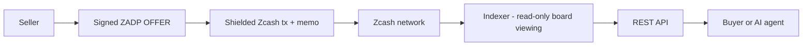
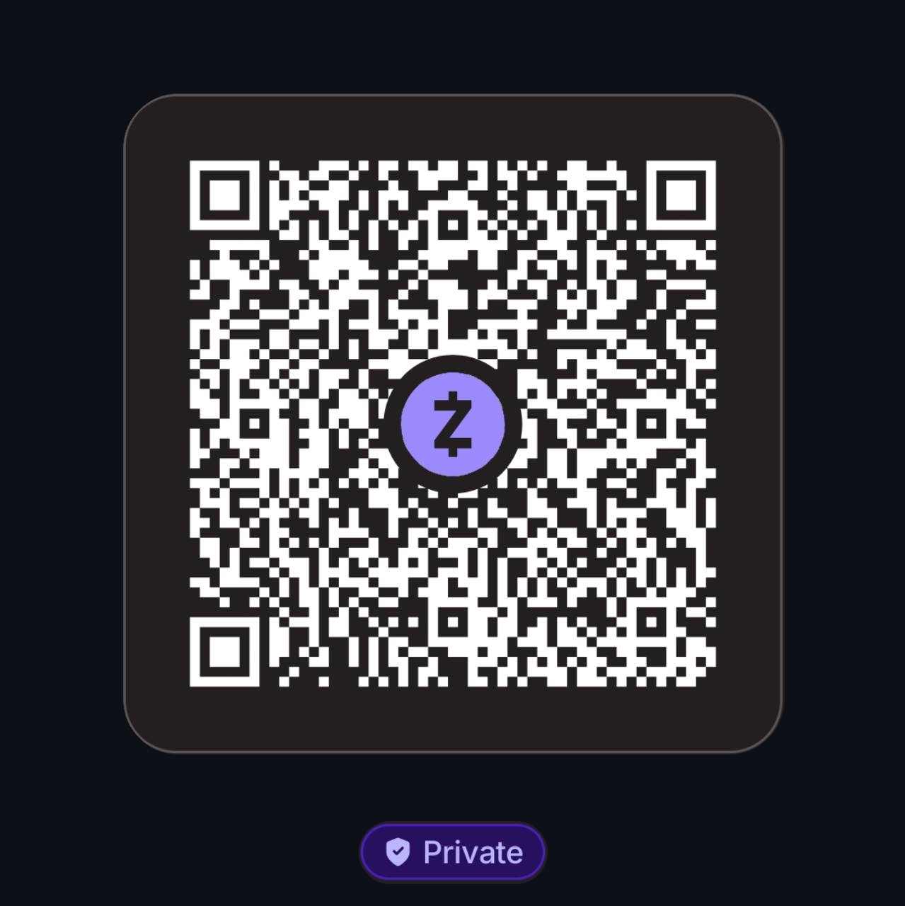

# ZADP


**Zcash Agent Discovery Protocol**

[](https://github.com/ZADP-protocol/ZADP/actions/workflows/ci.yml)

A permissionless service-discovery protocol where sellers publish signed offers through Zcash shielded memos and humans or autonomous agents can discover them through independently operated indexers.


*Concept illustration. Web/game interfaces, autonomous buyers and real purchase settlement are planned capabilities; live mainnet publication and independent discovery were verified on 2026-10-05. Paid service execution remains planned.*

## Why ZADP?

AI agents and applications increasingly need to discover paid services. Most discovery today depends on centralized registries. Public payment rails can also expose commercial relationships.

ZADP experiments with Zcash as a **permissionless publication** layer (and, later, a private settlement path). This is a design choice with specific properties—not a claim that blockchain discovery is universally better:

- permissionless publication to a dedicated shielded board
- cryptographically signed offers (seller Ed25519 identity, independent of Zcash keys)
- independently reproducible indexing from chain data + a portable board descriptor
- Zcash-native shielded memos for offer transport
- pseudonymous sellers
- private buyer→seller settlement as a **related / future** capability (not required for discovery)

Open publication is subject to each board’s **admission policy** (e.g. open or operator-authorized sellers). Anyone can run an indexer; hosted indexing or a high-availability API may be offered commercially while the protocol remains self-hostable.

## How it works



**Privacy boundary:** offer publication is intentionally discoverable by holders of the board’s public incoming viewing information. Purchases are **not** meant to go through that board viewing capability; settlement (when implemented for real) is direct buyer→seller.

**Hard invariant:** no AI/LLM process may possess a Zcash spending key. Agents may request payment through a separate controller; spending stays in a wallet boundary.

### Visual overview


This conceptual overview separates board discovery from direct buyer-to-seller payments. Indexers use the board’s **Unified Incoming Viewing Key (UIVK)** to read offers and validate their signatures and admission policy; this capability cannot spend funds or read unrelated seller payments. Offers use compact CBOR within the 512-byte memo budget. The implemented discovery endpoints are `GET /offers` and `GET /healthz`.

Mainnet offer discovery and local self-payment fulfillment have been verified. An independent buyer purchase and public service deployment remain pending. The pictured service listings are illustrative. See [Protocol](docs/protocol.md), [Mainnet acceptance](docs/mainnet-acceptance.md) and [Paid service flow](docs/paid-service-flow.md) for implementation details.

## Current status

| Area | Status |
| --- | --- |
| Signed `offer` messages, Ed25519 seller identity | **Implemented** |
| Canonical signing + 512-byte memo framing (`0xf5` + `ZADP` + wire v1 + CBOR) | **Implemented** |
| Board descriptor, board binding, admission policy | **Implemented** |
| CompactTxStreamer scanner (trial decrypt + full memo fetch) | **Implemented** (code + offline tests) |
| SQLite indexer, cursor, replay / reorg handling | **Implemented** |
| Mainnet board HTTP: `GET /offers`, `GET /healthz` | **Implemented** |
| Seller CLI: `identity-*`, `board-sign`, `publish` (Zallet PCZT) | **Implemented** (developer preview) |
| Mock demo: invoice / policy / mock pay / fulfill | **Implemented** (local only) |
| Live mainnet publish → mine → scan → API acceptance | **Verified 2026-10-05** — mined OFFER + two independent indices; [public evidence](docs/mainnet-acceptance.md) |
| Payment-gated text service | **Implemented experimental local path** — authenticated seller observer + persistent invoices; synthetic tests, live buyer payment still pending |
| Local web UI | **Implemented** — discovery, drafts, exact memo budget, optional read-only wallet/QR, unsigned publication costs and local invoice instructions |
| MCP / reputation / hosted marketplace | **Not implemented** |
| `offer_update` / `offer_revoke` | **Specified only** |

Do **not** treat CompactTxStreamer support or offline fixtures as proof of live-network acceptance.

## Protocol overview

1. **Discovery** — seller publishes a board-bound signed `offer` in a shielded memo.
2. **Indexing** — indexer scans with the board UIVK, validates, and stores current offer state.
3. **Commerce** — buyer contacts the seller `endpoint` directly (HTTP).
4. **Settlement** — future/related flow: shielded ZEC buyer→seller; not the board-discovery path.

### Read offers without control of funds

An indexer uses the board's **Unified Incoming Viewing Key (UIVK)** to decrypt
incoming board outputs and read their offer memos and values. This key **cannot
sign transactions or spend ZEC**. It is intentionally included in the signed
public board descriptor, so independent operators can reconstruct discovery
without access to a wallet or its spending keys. The first mainnet offer was
verified this way by two independent indices.

The browser UI only reads the indexer's HTTP API; it does not need even the
UIVK. Publish only a dedicated board's incoming viewing authority: never a
personal seller viewing key, full viewing key, seed or spending key. Board
content is readable by descriptor holders; this is public discovery, not a
confidential mailbox. Details: [board descriptor](docs/board-descriptor.md).

## Zcash architecture

ZADP uses Zcash for:

- shielded outputs carrying encrypted memos
- separation of **incoming viewing** (board/indexer) from **spending** (seller wallet only)
- CompactTxStreamer / lightwalletd-style scanning of compact blocks

A public board UIVK makes board-bound values and memos visible to descriptor holders by design. That is narrower than a full viewing key and does **not** authorize spends. It is not stronger privacy than Zcash itself provides.

Publication today targets local **Zallet** PCZT RPC; scanning uses a lightwalletd-compatible service. See [docs/mainnet-publishing.md](docs/mainnet-publishing.md) and [docs/zcash-scanning.md](docs/zcash-scanning.md).

## Illustrative offer (human-readable)

JSON for humans/REST—not the canonical wire/memo encoding. Field names match the protocol (`zadp`, not a legacy `zap` key):

```json
{
  "zadp": 1,
  "type": "offer",
  "id": "01JEXAMPLE…",
  "seller": "ed25519:…",
  "capability": "llm.inference",
  "title": "Example inference",
  "price": { "amount": "0.01", "currency": "ZEC" },
  "endpoint": "https://seller.example/zadp",
  "expires_at": "2026-10-04T12:00:00Z",
  "nonce": "…",
  "board_id": "…",
  "issued_at": "2026-10-03T12:00:00Z",
  "signature": "…"
}
```

Canonical signing and memo layout: [docs/protocol.md](docs/protocol.md).

## Quick start

### Local mock demo

End-to-end mock discovery + invoice + policy + mock payment (no ZEC):

```sh
cargo run -p zadp-demo
```

### Real Zcash scanner (developer preview)

Prerequisites: synchronized CompactTxStreamer/lightwalletd endpoint, signed public `board.json` (Orchard-only UA + UIVK + birthday), Rust stable.

```sh
cargo run -p zadp-api -- --network mainnet --board board.json \
  --lightwalletd https://YOUR-SERVICE:PORT \
  --database board.sqlite --listen 127.0.0.1:8080
```

```sh
curl 'http://127.0.0.1:8080/offers?capability=llm.inference'
```

Funded publication (`zadp-seller publish`, optional `--dry-run`) is a separate privileged path: [Mainnet publishing](docs/mainnet-publishing.md). Automated tests never broadcast.

## API

### Mainnet board router (`zadp-api` binary)

| Method | Path | Notes |
| --- | --- | --- |
| `GET` | `/healthz` | Liveness |
| `GET` | `/offers?capability=` | Indexed offers + chain metadata |

There is **no** `GET /offers/{id}` in the current mainnet router.

### Mock commerce router (demo / `router()` helper)

Used by `zadp-demo` only—not the production board daemon:

| Method | Path |
| --- | --- |
| `GET` | `/healthz` |
| `GET` | `/offers` |
| `POST` | `/v1/invoices` |
| `POST` | `/v1/fulfill` |

## Crates

| Crate | Role |
| --- | --- |
| `zadp-protocol` | Messages, board descriptor, signing, memo encode/decode |
| `zadp-zcash` | `BoardSource` / scanner, mock adapter, lightwalletd client |
| `zadp-indexer` | Validation, SQLite persistence, reorg-aware sync |
| `zadp-api` | Board scanner binary + HTTP routers |
| `zadp-seller` | Identity, `board-sign`, Zallet `publish` CLI + mock seller service |
| `zadp-payment` | Spending policy + `request_payment` (mock path) |
| `zadp-demo` | One-command mock vertical slice |

## Security model

- AI/LLM processes never hold Zcash spending keys
- Offers are signed; memos and chain data are untrusted input
- Board policy, expiry, replay/duplicate handling in the indexer
- Seller publish path: local wallet only, explicit confirmation (default), dry-run available

See [docs/threat-model.md](docs/threat-model.md).

## Decentralization and hosting

ZADP is a **protocol**, not a mandatory marketplace. Operators can publish boards and run indexers independently. Optional hosted indexing or managed APIs can coexist; they must not be required to speak the protocol.

## Roadmap (summary)

1. **Done:** first live mainnet offer publication and independent discovery; [evidence](docs/mainnet-acceptance.md)
2. **Done:** locally tested English UI, Rust memo parity, read-only wallet and unsigned fee previews
3. **Next:** approve a real paid service test after reviewing endpoint, invoice and transaction costs
4. Stable self-hosted API / ops docs
5. Optional hosted indexing
6. Agent/MCP buyer tools (still no spending keys in the model)
7. Production hardening and broader shielded purchase support

Details: [docs/roadmap.md](docs/roadmap.md).

## Local interface

Run `python3 ui/server.py` and open http://127.0.0.1:8090 with a local indexer on port 8080. The English-only UI shows real indexed offers, saves unsigned drafts in the browser, and includes a free local text-shortening test service (no AI model or payment). Optional protected operator integration shows filtered seller wallet readiness and a receive QR, prepares authoritative unsigned publication costs, and bridges invoices/payment checks to the local TLS text service. No UI route signs, broadcasts or transfers funds. Live buyer payment remains pending separate approval. See [UI instructions](ui/README.md).

## Development

```sh
cargo fmt --check
cargo clippy --workspace --all-targets --all-features -- -D warnings
cargo test --workspace
```

CI (fmt, clippy, tests, demo smoke): `.github/workflows/ci.yml`.

## Agent coordination (optional, local)

Operators may use a local file inbox for handing tasks between agents (pending → result → archive). That path is **gitignored** and is not part of the public protocol surface.

## Documentation

- [Architecture](docs/architecture.md)
- [Protocol](docs/protocol.md)
- [Board descriptor](docs/board-descriptor.md)
- [Zcash scanning](docs/zcash-scanning.md)
- [Mainnet publishing](docs/mainnet-publishing.md)
- [Threat model](docs/threat-model.md)
- [Roadmap](docs/roadmap.md)
- [Zcash integration TODOs](docs/zcash-integration-todos.md)

## License

Workspace `Cargo.toml` declares **`MIT OR Apache-2.0`**. Standalone `LICENSE` / `LICENSE-*` files are **not** present in the repository yet; treat SPDX as intended dual-licensing pending finalized license text files.


## Developer and release documents

- [Development and troubleshooting](docs/development.md)
- [Paid-service milestone design](docs/paid-service-flow.md)
- [Dependency review](docs/dependencies.md)
- [Two-minute demo](docs/hackathon-demo.md) and [submission draft](docs/hackathon-submission-draft.md)
- [Security reporting](SECURITY.md), [contributing](CONTRIBUTING.md), [dual license](LICENSE)

These are preparation materials, not a public deployment, hackathon submission
or claim that real buyer settlement is complete.

## Donate

Support ZADP development with a Zcash (ZEC) donation to this Unified Address:

```text
u1x599z4k4ff286gfkajzpmzj9g98xqk2cr9tkktnwr9fv7h6sjrzznttxpjuetfcu7ac722l2x8959s435vn20ll2s0zkgh67qhlhrl2mjg32q27t3lep20fenunkr5gr2umz32gh23hkp85yhqnf8s4lsdrqa8kr8emxv75mvqqlymau
```



The QR code contains exactly the address above, with no preset amount or memo.
