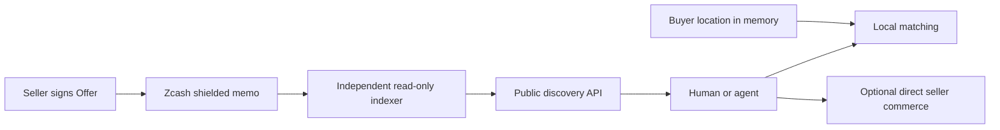

# ZADP — Zcash Agent Discovery Protocol

ZADP discovers seller-signed service Offers through Zcash shielded memos.
It separates public discovery from direct buyer–seller interaction and payment.
Independent indexers can reconstruct a board without wallet spending authority;
humans and agents can use the same discovery data without zadp.io.

## Why it exists

A discovery host should not need custody of buyer funds, private order payloads,
or buyer GPS to match services. Seller signatures authenticate declarations;
they do not guarantee identity/KYC, quality, availability or fulfillment.

## Architecture overview




Core owns protocol, reference scanning/indexing/API, reusable clients and tests.
Web owns the hosted product; Hosted owns optional moderation and visibility;
Seller owns multi-Offer fulfillment; Server owns instance operations. MCP is a
separate read-only adapter over Hosted discovery. No private repository is required to implement ZADP.
See [architecture](docs/architecture.md) and [repository boundaries](docs/repository-boundaries.md).

## Protocol 1.0

New publications use **canonical Offer/model/wire 3** and signing prefix
`ZADP3\0offer\0`. BoardDescriptor remains version 1. **Wire 1/2 are
pre-release legacy**, readable for historical verification only; supported
new-publication tooling rejects them. Published signed bytes are not rewritten.

Optional primitives are `geo`, fixed ZEC `price`, and `commerce.endpoint`:

- No endpoint/price: discovery announcement.
- Endpoint without price: seller service announcement, no ZADP payment.
- Endpoint with price: fixed-price service candidate.
- Price without endpoint: invalid.

Geo is optional in all valid combinations. The memo envelope is 512 bytes with
an exact 504-byte payload budget. Expired Offers leave active discovery; renewal
creates a new signed Offer. `offer_revoke` is an additive signed control message ([design](docs/offer-revoke.md)); `offer_update` remains unimplemented.
See the [normative specification](docs/protocol.md).

## Discovery and privacy

Signed BoardDescriptor policy binds network, receiving address, incoming viewing
capability, birthday and admission. Incoming capability cannot spend. Public
Offer metadata is readable by holders of that capability; shielding does not
make a public board confidential. Independent SQLite indexes pin descriptor
fingerprints and keep board state isolated. Host visibility is separate from
protocol validity and board admission.

Buyer Nearby matching uses public service-area centers and local Haversine
intersection. Buyer GPS stays in browser memory, not discovery requests or
persistent storage. Ordinary network metadata remains visible to servers.
See [geo](docs/geographic-discovery.md) and [privacy/data flow](docs/privacy.md).

## Direct seller commerce

A signed endpoint is only a candidate. Its offline-signed `/.well-known/zadp`
proof binds seller identity to HTTPS-origin control. It proves neither KYC nor
service quality. Hosted Buy also requires active/visible signed terms, fixed
price, supported capability and fresh seller `orders_available`.

Orders, input, payment correlation and results go directly to the seller.
A separate buyer wallet approves payment; discovery neither processes payments
nor holds spending keys. Seller SQLite currently stores private input/results
in plaintext; automated retention/redaction is not implemented. An agent may
request payment only through policy/controller boundaries.
See [commerce](docs/commerce.md), [endpoint proof](docs/endpoint-ownership.md)
and [threat model](docs/threat-model.md).

## What has been verified on mainnet

Legacy publication and independent reconstruction, geo publication, canonical
wire-3 geo discovery and one real **human** buyer→seller summary-service purchase
have been verified. Seller fulfillment waited for confirmations and executed
exactly once. The checked-in evidence is a dated milestone record, not a live inventory or
current deployment report. Agent offline acceptance and a live unpaid order
preparation are not proof of a completed agent mainnet purchase.
See [mainnet evidence summary](docs/mainnet-evidence.md).

## Hosted service and reference implementation

[Open zadp.io](https://zadp.io/). The hosted product is optional and uses
local/self-hosted cartography. Its access policy is an operator choice, separate
from the protocol. For AI clients, see the [MCP connection guide](https://zadp.io/mcp.html).


*Web-only DEMO inventory is separate from signed chain inventory, cannot be
purchased and is not mainnet payment evidence.*

```sh
cargo build --workspace
cargo run -p zadp-api -- \
  --network testnet \
  --board /absolute/path/to/example-board.json \
  --lightwalletd https://your-testnet-lightwalletd.example:443 \
  --database /absolute/path/to/index.sqlite \
  --listen 127.0.0.1:8080
```

Use a valid signed descriptor matching the transport network. Scanning needs no
wallet/spending key. See [development and tests](docs/development.md),
[reference browser](examples/browser/README.md) and
[reusable browser modules](client/browser/README.md).

## Documentation

- [Normative protocol](docs/protocol.md) · [BoardDescriptor](docs/board-descriptor.md)
- [HTTP API](docs/api.md) · [Architecture](docs/architecture.md)
- [Security](SECURITY.md) · [Threat model](docs/threat-model.md)
- [Privacy](docs/privacy.md) · [Glossary](docs/glossary.md)
- [Mainnet evidence](docs/mainnet-evidence.md) · [Roadmap](docs/roadmap.md)
- [Release checklist](docs/PUBLIC_RELEASE_CHECKLIST.md) · [Contributing](CONTRIBUTING.md)

## Support the project

Project support is independent of protocol admission and hosted publication pricing.

## Sponsors

_No sponsors yet._

**Sponsor — 0.1 ZEC**

Public name/project listing with one HTTPS link in this Sponsors section.
README visibility only; no logos, badges or additional marketing text.

**Pay with ZEC:** scan the QR below or copy this complete ZIP-321 payment request into your Zcash
wallet. It specifies the project recipient and exact sponsorship amount, with no memo:

```text
zcash:u1x599z4k4ff286gfkajzpmzj9g98xqk2cr9tkktnwr9fv7h6sjrzznttxpjuetfcu7ac722l2x8959s435vn20ll2s0zkgh67qhlhrl2mjg32q27t3lep20fenunkr5gr2umz32gh23hkp85yhqnf8s4lsdrqa8kr8emxv75mvqqlymau?amount=0.1
```


[PNG QR fallback](docs/images/zadp-sponsor-qr.png) · **0.1 ZEC**, excluding network fees.
Scan the QR to load the recipient and amount; **add your sponsorship memo manually** before paying.

Manually enter this memo in your wallet before approving payment:

```text
ZADP-SPONSOR|sponsor|public=YOUR_NAME|url=https://YOUR_URL
```

Example:

```text
ZADP-SPONSOR|sponsor|public=AliceLabs|url=https://alice.example
```

**Sponsor ZADP** — Purchase project sponsorship visibility with ZEC.
Project sponsorship placements are available in ZEC.

Sponsor listings have no fixed term and remain visible while the ZADP Sponsors section is maintained.

Sponsorship uses the public project Unified Address:

```text
u1x599z4k4ff286gfkajzpmzj9g98xqk2cr9tkktnwr9fv7h6sjrzznttxpjuetfcu7ac722l2x8959s435vn20ll2s0zkgh67qhlhrl2mjg32q27t3lep20fenunkr5gr2umz32gh23hkp85yhqnf8s4lsdrqa8kr8emxv75mvqqlymau
```

`public=` is the name/project name you authorize us to publish. `url=` is the
single HTTPS link you authorize us to publish. Replace the placeholders yourself;
sponsor names and links are not automatically included in payment requests.
Network fees are additional: review the recipient, amount, memo and wallet fee
before sending. Never send a second payment merely because a listing is pending.

The sponsor QR encodes exactly the complete ZIP-321 URI above: the project
Unified Address and sponsorship amount only, with no sponsor name, URL or memo. Wallet
ZIP-321 support is required; verify the amount and recipient after scanning.
QRs use square dark modules (`#0D1117`) on an opaque white background with a
four-module quiet zone, no logo, and no transparent background. SVGs and PNG
fallbacks remain readable on GitHub light and dark backgrounds.

**Manual review and publication:** the maintainer checks the wallet and shielded
memo, confirms the amount, reviews the name and HTTPS link, and manually
adds approved listings as simple Markdown text links. Publication is not
automatic. There is no sponsorship watcher, sponsor database, backend API or
automatic README/GitHub update. The project may refuse names or links containing
malicious links, impersonation, illegal content, deceptive affiliation claims,
malware or abusive content. Payment does not bypass manual review.

**Privacy:** the payment may be shielded, but the value provided in `public=`
and the `url=` link are intentionally published in the README after manual
approval. Do not include seeds, spending keys, wallet credentials or other
private information in the memo.

Project sponsorship is separate from the ZADP protocol. Sponsorship grants no
protocol privileges and does not affect offer ranking, board admission, protocol validity,
moderation, discovery, seller commerce, indexer behavior or reputation.
Sponsorship provides README visibility only.


## License

MIT OR Apache-2.0, at your option. See [MIT](LICENSE-MIT), [Apache](LICENSE-APACHE) and [license notice](LICENSE). Third-party dependencies retain their own licenses. Repository visibility is a separate owner decision; this cleanup does not make any repository public.

## Optional hosted moderation

Core can run standalone without content moderation. `zadp-api` exposes canonical
active discovery; it neither installs hosted policy tables nor provides report
or admin routes. [ZADP-Hosted](https://github.com/ZADP-protocol/ZADP-Hosted) adds
operator visibility and abuse handling explicitly. ZADP-Server owns deployment
operations. Hosted decisions never alter protocol validation or Offer signatures.
