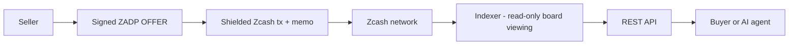
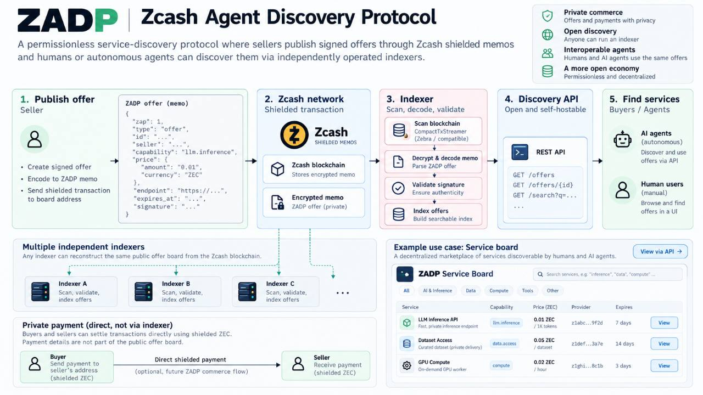
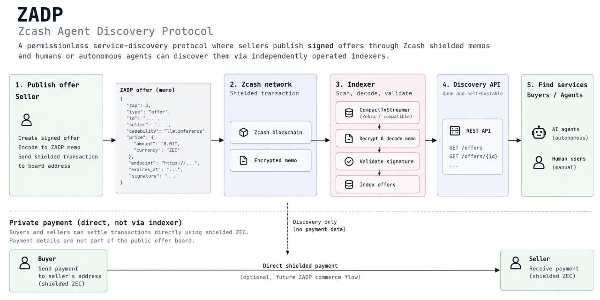

# ZADP

**Zcash Agent Discovery Protocol**

[](https://github.com/ZADP-protocol/ZADP/actions/workflows/ci.yml)

A permissionless service-discovery protocol where sellers publish signed offers through Zcash shielded memos and humans or autonomous agents can discover them through independently operated indexers.


*Concept illustration. Web/game interfaces, autonomous buyers and real purchase settlement are planned capabilities; live mainnet publication and independent discovery were verified on 2026-10-05. Paid service execution remains planned.*

## Why ZADP?

AI agents and applications increasingly need to discover paid services. Most discovery today depends on centralized registries. Public payment rails can also expose commercial relationships.

ZADP experiments with Zcash as a **permissionless publication** layer (and, later, a private settlement path). This is a design choice with specific properties—not a claim that blockchain discovery is universally better:

- permissionless publication to a dedicated shielded board
- cryptographically signed offers (seller Ed25519 identity, independent of Zcash keys)
- independently reproducible indexing from chain data + a portable board descriptor
- Zcash-native shielded memos for offer transport
- pseudonymous sellers
- private buyer→seller settlement as a **related / future** capability (not required for discovery)

Open publication is subject to each board’s **admission policy** (e.g. open or operator-authorized sellers). Anyone can run an indexer; hosted indexing or a high-availability API may be offered commercially while the protocol remains self-hostable.

## How it works



**Privacy boundary:** offer publication is intentionally discoverable by holders of the board’s public incoming viewing information. Purchases are **not** meant to go through that board viewing capability; settlement (when implemented for real) is direct buyer→seller.

**Hard invariant:** no AI/LLM process may possess a Zcash spending key. Agents may request payment through a separate controller; spending stays in a wallet boundary.

### Visual overview





These are conceptual diagrams, not implementation specifications. Their illustrative JSON uses a legacy `zap` field; the actual protocol uses `zadp` and compact binary memo encoding. The current board API provides `GET /offers` and `GET /healthz`; the pictured `/offers/{id}` and `/search` endpoints are not implemented. Board offers are readable by holders of the public board incoming viewing capability, despite the encrypted transport. Real purchase settlement and the pictured client interfaces remain future work. See [Protocol](docs/protocol.md) and the status checklist below for current behavior.

## Current status

| Area | Status |
| --- | --- |
| Signed `offer` messages, Ed25519 seller identity | **Implemented** |
| Canonical signing + 512-byte memo framing (`0xf5` + `ZADP` + wire v1 + CBOR) | **Implemented** |
| Board descriptor, board binding, admission policy | **Implemented** |
| CompactTxStreamer scanner (trial decrypt + full memo fetch) | **Implemented** (code + offline tests) |
| SQLite indexer, cursor, replay / reorg handling | **Implemented** |
| Mainnet board HTTP: `GET /offers`, `GET /healthz` | **Implemented** |
| Seller CLI: `identity-*`, `board-sign`, `publish` (Zallet PCZT) | **Implemented** (developer preview) |
| Mock demo: invoice / policy / mock pay / fulfill | **Implemented** (local only) |
| Live mainnet publish → mine → scan → API acceptance | **Pending** — not demonstrated |
| Real shielded purchase settlement | **Not implemented** (mock only) |
| MCP / web UI / reputation / hosted marketplace | **Not implemented** |
| `offer_update` / `offer_revoke` | **Specified only** |

Do **not** treat CompactTxStreamer support or offline fixtures as proof of live-network acceptance.

## Protocol overview

1. **Discovery** — seller publishes a board-bound signed `offer` in a shielded memo.
2. **Indexing** — indexer scans with the board UIVK, validates, and stores current offer state.
3. **Commerce** — buyer contacts the seller `endpoint` directly (HTTP).
4. **Settlement** — future/related flow: shielded ZEC buyer→seller; not the board-discovery path.

Indexers must never need a spending key to discover offers. Details: [docs/protocol.md](docs/protocol.md).

## Zcash architecture

ZADP uses Zcash for:

- shielded outputs carrying encrypted memos
- separation of **incoming viewing** (board/indexer) from **spending** (seller wallet only)
- CompactTxStreamer / lightwalletd-style scanning of compact blocks

A public board UIVK makes board-bound values and memos visible to descriptor holders by design. That is narrower than a full viewing key and does **not** authorize spends. It is not stronger privacy than Zcash itself provides.

Publication today targets local **Zallet** PCZT RPC; scanning uses a lightwalletd-compatible service. See [docs/mainnet-publishing.md](docs/mainnet-publishing.md) and [docs/zcash-scanning.md](docs/zcash-scanning.md).

## Illustrative offer (human-readable)

JSON for humans/REST—not the canonical wire/memo encoding. Field names match the protocol (`zadp`, not a legacy `zap` key):

```json
{
  "zadp": 1,
  "type": "offer",
  "id": "01JEXAMPLE…",
  "seller": "ed25519:…",
  "capability": "llm.inference",
  "title": "Example inference",
  "price": { "amount": "0.01", "currency": "ZEC" },
  "endpoint": "https://seller.example/zadp",
  "expires_at": "2026-10-04T12:00:00Z",
  "nonce": "…",
  "board_id": "…",
  "issued_at": "2026-10-03T12:00:00Z",
  "signature": "…"
}
```

Canonical signing and memo layout: [docs/protocol.md](docs/protocol.md).

## Quick start

### Local mock demo

End-to-end mock discovery + invoice + policy + mock payment (no ZEC):

```sh
cargo run -p zadp-demo
```

### Real Zcash scanner (developer preview)

Prerequisites: synchronized CompactTxStreamer/lightwalletd endpoint, signed public `board.json` (Orchard-only UA + UIVK + birthday), Rust stable.

```sh
cargo run -p zadp-api -- --network mainnet --board board.json \
  --lightwalletd https://YOUR-SERVICE:PORT \
  --database board.sqlite --listen 127.0.0.1:8080
```

```sh
curl 'http://127.0.0.1:8080/offers?capability=llm.inference'
```

Funded publication (`zadp-seller publish`, optional `--dry-run`) is a separate privileged path: [Mainnet publishing](docs/mainnet-publishing.md). Automated tests never broadcast.

## API

### Mainnet board router (`zadp-api` binary)

| Method | Path | Notes |
| --- | --- | --- |
| `GET` | `/healthz` | Liveness |
| `GET` | `/offers?capability=` | Indexed offers + chain metadata |

There is **no** `GET /offers/{id}` in the current mainnet router.

### Mock commerce router (demo / `router()` helper)

Used by `zadp-demo` only—not the production board daemon:

| Method | Path |
| --- | --- |
| `GET` | `/healthz` |
| `GET` | `/offers` |
| `POST` | `/v1/invoices` |
| `POST` | `/v1/fulfill` |

## Crates

| Crate | Role |
| --- | --- |
| `zadp-protocol` | Messages, board descriptor, signing, memo encode/decode |
| `zadp-zcash` | `BoardSource` / scanner, mock adapter, lightwalletd client |
| `zadp-indexer` | Validation, SQLite persistence, reorg-aware sync |
| `zadp-api` | Board scanner binary + HTTP routers |
| `zadp-seller` | Identity, `board-sign`, Zallet `publish` CLI + mock seller service |
| `zadp-payment` | Spending policy + `request_payment` (mock path) |
| `zadp-demo` | One-command mock vertical slice |

## Security model

- AI/LLM processes never hold Zcash spending keys
- Offers are signed; memos and chain data are untrusted input
- Board policy, expiry, replay/duplicate handling in the indexer
- Seller publish path: local wallet only, explicit confirmation (default), dry-run available

See [docs/threat-model.md](docs/threat-model.md).

## Decentralization and hosting

ZADP is a **protocol**, not a mandatory marketplace. Operators can publish boards and run indexers independently. Optional hosted indexing or managed APIs can coexist; they must not be required to speak the protocol.

## Roadmap (summary)

1. **Next:** live mainnet acceptance (publish → mine → scan → API), public evidence without wallet secrets
2. Stable self-hosted API / ops docs
3. Optional hosted indexing
4. Agent/MCP buyer tools (still no spending keys in the model)
5. Real shielded settlement beyond the mock demo

Details: [docs/roadmap.md](docs/roadmap.md).

## Development

```sh
cargo fmt --check
cargo clippy --workspace --all-targets --all-features -- -D warnings
cargo test --workspace
```

CI (fmt, clippy, tests, demo smoke): `.github/workflows/ci.yml`.

## Agent coordination (optional, local)

Operators may use a local file inbox for handing tasks between agents (pending → result → archive). That path is **gitignored** and is not part of the public protocol surface.

## Documentation

- [Architecture](docs/architecture.md)
- [Protocol](docs/protocol.md)
- [Board descriptor](docs/board-descriptor.md)
- [Zcash scanning](docs/zcash-scanning.md)
- [Mainnet publishing](docs/mainnet-publishing.md)
- [Threat model](docs/threat-model.md)
- [Roadmap](docs/roadmap.md)
- [Zcash integration TODOs](docs/zcash-integration-todos.md)

## License

Workspace `Cargo.toml` declares **`MIT OR Apache-2.0`**. Standalone `LICENSE` / `LICENSE-*` files are **not** present in the repository yet; treat SPDX as intended dual-licensing pending finalized license text files.
