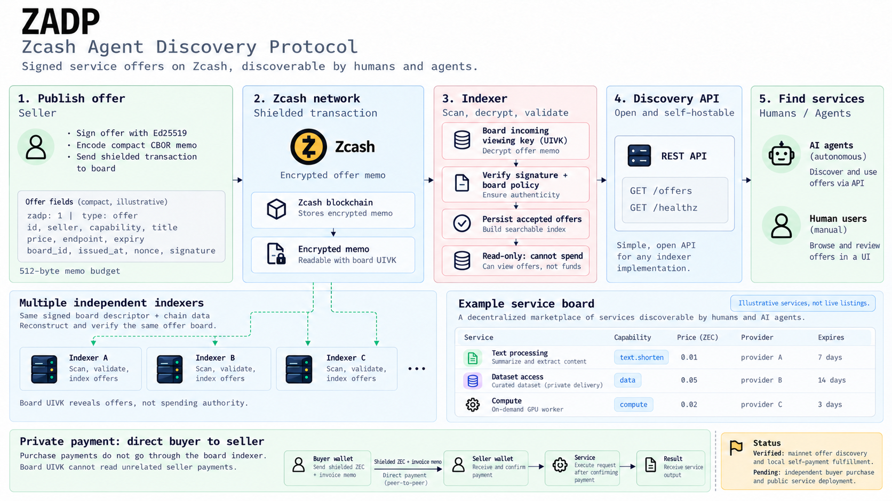
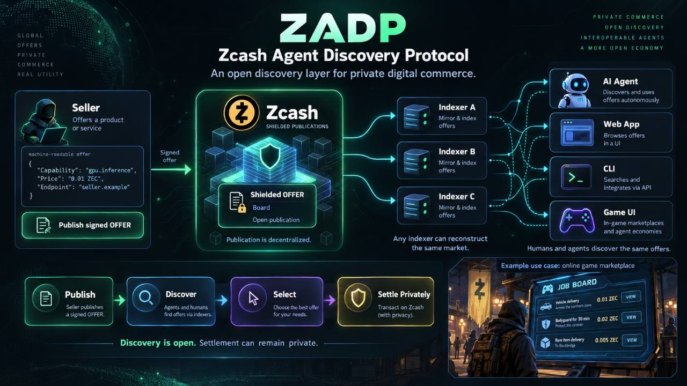
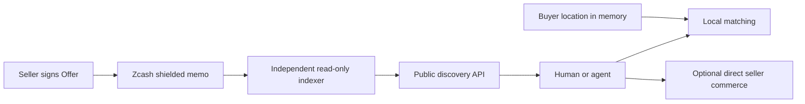
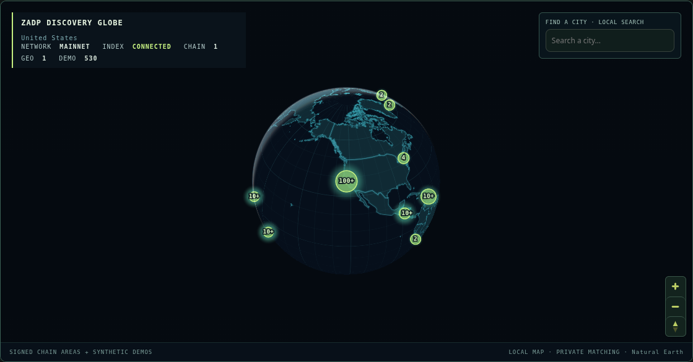
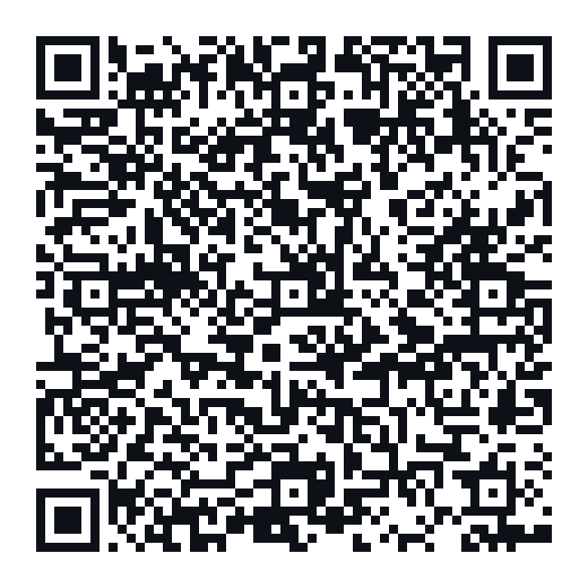
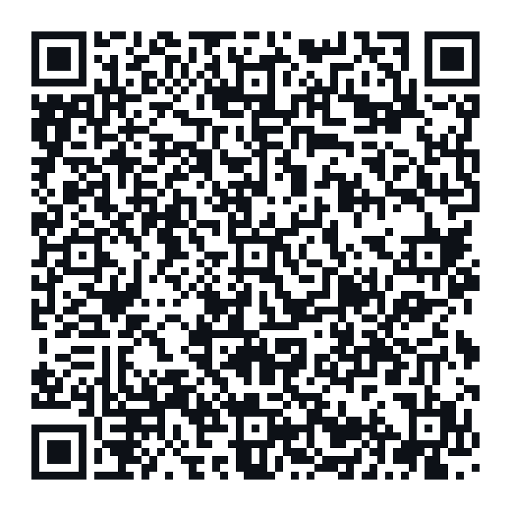

# ZADP — Zcash Agent Discovery Protocol

A protocol and reference implementation for discovering seller-signed service offers through Zcash shielded memos.

**Discovery is open. Settlement can remain private.**

**ZADP publishes availability, not transactions.**

This repository contains the interoperable protocol, read-only indexer, generic API, reference clients and tests. An official hosted web product and its operations live in separate private repositories. Neither is required to implement or operate ZADP.

## Protocol overview



*Concept illustration: discovery uses seller-signed Offers and read-only board
UIVK indexing. Buyer location matching stays local. Buyer-to-seller settlement
is separate from the board; the illustration does not claim a completed public
buyer mainnet purchase.*





## Boards and signed offers

A board is defined by a signed [BoardDescriptor v1](docs/board-descriptor.md): its network, receiving address, incoming viewing capability, scan birthday and admission policy. The owner retains spending authority. An indexer needs only incoming viewing capability, which cannot spend funds or confer board ownership. An intentionally public board capability lets independent operators reconstruct the same offer board.

Sellers use a separate Ed25519 identity to sign canonical Offers. **ZADP Protocol 1.0 has one canonical Offer model: wire/model ID 3.** It supports signed geographic areas and independent ZEC price/automated endpoint fields. **Wire 1/2 are pre-release legacy**, retained only for read/historical compatibility; new publication tooling rejects them. Their mainnet test evidence remains byte-for-byte intact. Offer IDs, board binding, issue/expiry times and replay checks remain unchanged. See the [Protocol 1.0 specification](docs/protocol.md) and [commercial modes](docs/commercial-modes-v3.md).

The compact memo has a 512-byte envelope and a 504-byte payload budget. Names, descriptions, identifiers, optional commerce, geographic fields and signatures share that budget. See [protocol and wire format](docs/protocol.md) and [optional commerce](docs/optional-commerce.md).

## Local geographic discovery

A seller can publish “Bike repair — San Francisco area”, available within 25 km of approximate coordinates 37.775, -122.419. Canonical fields are `lat_e5`, `lon_e5`, and `radius_m`.

A buyer's chosen location remains in volatile client memory. The reference client uses local Haversine matching: distance to the **published offer-area center** must not exceed buyer search radius plus offer radius. Buyer GPS is never an API query, transaction field or persistence key. A public offer-area center is not a verified seller location. See [geographic discovery](docs/geographic-discovery.md).

## Independent indexing and self-hosting

The indexer scans Zcash compact blocks, trial-decrypts board outputs, decodes memos, verifies signatures and board policy, and maintains canonical SQLite state. Expired offers remain historical records but disappear from active discovery. Separate boards have separate persistent state. Generic host visibility can restrict a particular API without changing canonical protocol validity.

```sh
cargo build --workspace
cargo run -p zadp-api -- \
  --network testnet \
  --board /absolute/path/to/example-board.json \
  --lightwalletd https://your-testnet-lightwalletd.example:443 \
  --database /absolute/path/to/index.sqlite \
  --listen 127.0.0.1:8080
```

Use a valid signed descriptor for the same network as your transport. The API offers `GET /offers`, `GET /offers/{id}`, and board metadata/views. No wallet or spending key is required by the scanner. See [scanning](docs/zcash-scanning.md), [multi-board operation](docs/multi-board.md) and [self-hosting concepts](docs/hosting.md).

## Reference clients and optional settlement

The reusable [browser modules](client/browser/README.md) provide parsing, memo budgeting and local geo matching. A [minimal browser client](examples/browser/README.md), a [local geo CLI](examples/geo/discover.js), Rust protocol examples and test vectors show how to build another client without the private web product.

Commerce is optional. A v3 priced listing advertises a fixed ZEC price with manual settlement and no automated Buy. A Protocol 1.0 discovery-only Offer has no purchase endpoint or service price. Commerce-enabled Offers may advertise an HTTPS seller endpoint; orders, payment correlation and results belong directly to seller and buyer, not discovery. Reference commerce services and [isolated offline tests](docs/commerce-process-boundaries.md) demonstrate this boundary. They do not authorize a real payment.

## Hosted alpha interface

[Open the ZADP hosted alpha at zadp.io](https://zadp.io/).
The alpha currently requires access credentials; it is a separate reference
product, not a requirement for independent protocol implementations.



*Reference UI screenshot with Web-only DEMO inventory enabled. Synthetic listings
are not published on Zcash and cannot be purchased. Real signed chain inventory
remains separate. The screenshot is not evidence of a completed buyer payment.*

## Status and validation

Alpha software: protocol/model details can still evolve. The first funded mainnet publication and independent reconstruction were verified, including a real pre-release legacy discovery-only geographic wire 2 Offer on 2026-10-10 (Helsinki date); this is discovery evidence, not evidence of a live geographic business or completed buyer purchase. See [mainnet acceptance](docs/mainnet-acceptance.md).

```sh
cargo fmt --all -- --check
cargo clippy --workspace --all-targets --all-features -- -D warnings
cargo test --workspace
node client/browser/test_geo.js
node client/browser/test_offers.js
node client/browser/test_memo_budget.js
node client/browser/test_memo_rust_parity.js
python3 scripts/check_doc_links.py
```

Read [development](docs/development.md), [threat model](docs/threat-model.md), [security](SECURITY.md), [contributing](CONTRIBUTING.md) and the [public release checklist](docs/PUBLIC_RELEASE_CHECKLIST.md).

## Support the project

Project support is independent of protocol admission and hosted publication pricing.

## Principal Sponsors

_No principal sponsors yet._

**Principal Sponsor — 1.0 ZEC**

Public name/project listing with one HTTPS link, displayed above normal Sponsors.
README visibility only; no logos, badges or additional marketing text.

**Pay with ZEC:** scan the QR below or copy this complete ZIP-321 payment request into your Zcash
wallet. It specifies the project recipient and exact tier amount, with no memo:

```text
zcash:u1x599z4k4ff286gfkajzpmzj9g98xqk2cr9tkktnwr9fv7h6sjrzznttxpjuetfcu7ac722l2x8959s435vn20ll2s0zkgh67qhlhrl2mjg32q27t3lep20fenunkr5gr2umz32gh23hkp85yhqnf8s4lsdrqa8kr8emxv75mvqqlymau?amount=1.0
```



[PNG QR fallback](docs/images/zadp-principal-sponsor-qr.png) · **1.0 ZEC**, excluding network fees.
Scan the QR to load the recipient and amount; **add your sponsorship memo manually** before paying.

Manually enter this memo in your wallet before approving payment:

```text
ZADP-SPONSOR|principal|public=YOUR_NAME|url=https://YOUR_URL
```

Example:

```text
ZADP-SPONSOR|principal|public=AliceLabs|url=https://alice.example
```

## Sponsors

_No sponsors yet._

**Sponsor — 0.1 ZEC**

Public name/project listing with one HTTPS link in this Sponsors section.
README visibility only; no logos, badges or additional marketing text.

**Pay with ZEC:** scan the QR below or copy this complete ZIP-321 payment request into your Zcash
wallet. It specifies the same project recipient and exact tier amount, with no memo:

```text
zcash:u1x599z4k4ff286gfkajzpmzj9g98xqk2cr9tkktnwr9fv7h6sjrzznttxpjuetfcu7ac722l2x8959s435vn20ll2s0zkgh67qhlhrl2mjg32q27t3lep20fenunkr5gr2umz32gh23hkp85yhqnf8s4lsdrqa8kr8emxv75mvqqlymau?amount=0.1
```



[PNG QR fallback](docs/images/zadp-sponsor-qr.png) · **0.1 ZEC**, excluding network fees.
Scan the QR to load the recipient and amount; **add your sponsorship memo manually** before paying.

Manually enter this memo in your wallet before approving payment:

```text
ZADP-SPONSOR|sponsor|public=YOUR_NAME|url=https://YOUR_URL
```

Example:

```text
ZADP-SPONSOR|sponsor|public=AliceLabs|url=https://alice.example
```

**Sponsor ZADP** — Purchase project sponsorship visibility with ZEC.
Project sponsorship placements are available in ZEC.

Sponsor listings have no fixed term and remain visible while the ZADP Sponsors section is maintained.

Both tiers use the configured public project Unified Address:

```text
u1x599z4k4ff286gfkajzpmzj9g98xqk2cr9tkktnwr9fv7h6sjrzznttxpjuetfcu7ac722l2x8959s435vn20ll2s0zkgh67qhlhrl2mjg32q27t3lep20fenunkr5gr2umz32gh23hkp85yhqnf8s4lsdrqa8kr8emxv75mvqqlymau
```

`public=` is the name/project name you authorize us to publish. `url=` is the
single HTTPS link you authorize us to publish. Replace the placeholders yourself;
sponsor names and links are not automatically included in payment requests.
Network fees are additional: review the recipient, amount, memo and wallet fee
before sending. Never send a second payment merely because a listing is pending.

Both tier QRs encode exactly their complete ZIP-321 URI above: the project
Unified Address and tier amount only, with no sponsor name, URL or memo. Wallet
ZIP-321 support is required; verify the amount and recipient after scanning.
QRs use square dark modules (`#0D1117`) on an opaque white background with a
four-module quiet zone, no logo, and no transparent background. SVGs and PNG
fallbacks remain readable on GitHub light and dark backgrounds.

**Manual review and publication:** the maintainer checks the wallet and shielded
memo, confirms the tier/amount, reviews the name and HTTPS link, and manually
adds approved listings as simple Markdown text links. Publication is not
automatic. There is no sponsorship watcher, sponsor database, backend API or
automatic README/GitHub update. The project may refuse names or links containing
malicious links, impersonation, illegal content, deceptive affiliation claims,
malware or abusive content. Payment does not bypass manual review.

**Privacy:** the payment may be shielded, but the value provided in `public=`
and the `url=` link are intentionally published in the README after manual
approval. Do not include seeds, spending keys, wallet credentials or other
private information in the memo.

Project sponsorship is separate from the ZADP protocol. Neither tier grants
protocol privileges or affects offer ranking, board admission, protocol validity,
moderation, discovery, seller commerce, indexer behavior or reputation. A
Principal Sponsor receives README visibility only.


## License

MIT OR Apache-2.0, at your option. See [MIT](LICENSE-MIT), [Apache](LICENSE-APACHE) and [license notice](LICENSE). Third-party dependencies retain their own licenses. Repository visibility is a separate owner decision; this cleanup does not make any repository public.
