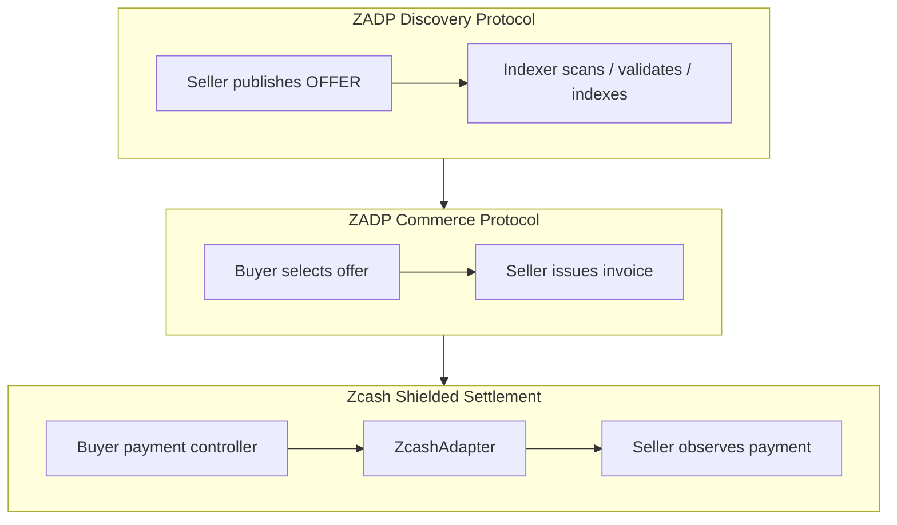
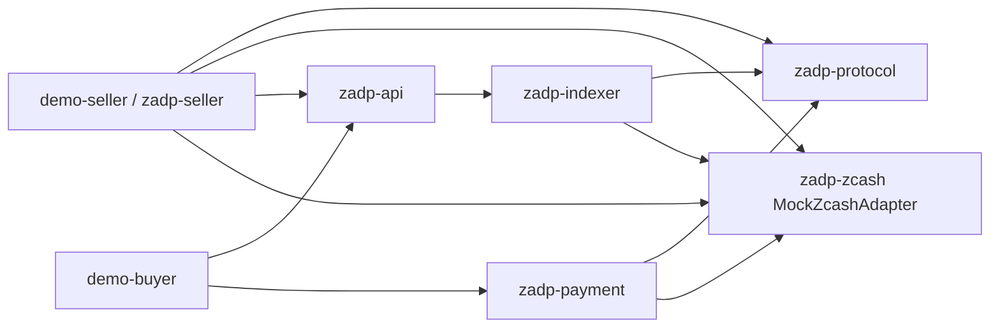
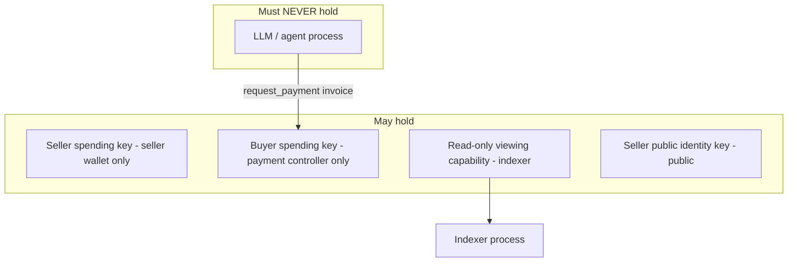

# ZADP Architecture

**ZADP** (Zcash Agent Discovery Protocol) is an open protocol and reference implementation for private commerce between humans, applications, and autonomous AI agents using Zcash.

This document describes the Phase 1 MVP architecture: a local vertical slice with a mock Zcash adapter.

## Goals

- Sellers publish cryptographically signed service offers via Zcash shielded channels.
- An indexer discovers, validates, and exposes offers over REST.
- Buyers (human or agent) request invoices and settle with shielded ZEC.
- AI/LLM processes may **request** payment but must **never** hold or use a Zcash spending key.

## Non-goals (MVP)

Marketplace UI, reputation, escrow, DID, production wallets, tokens, DAO governance, recommendation engines, and blockchain abstraction frameworks are out of scope.

## Conceptual layers

## Component diagram

## Domain boundaries

| Crate | Responsibility | Must not depend on |
| --- | --- | --- |
| `zadp-protocol` | Message types, canonical signing bytes, offer/invoice domain models, signature verify helpers | HTTP, storage, Zcash RPC |
| `zadp-zcash` | `ZcashAdapter` trait + `MockZcashAdapter` | Business rules beyond transport semantics |
| `zadp-indexer` | Scan → validate → store offer state | HTTP frameworks, AI models |
| `zadp-api` | REST surface over indexer + seller commerce endpoints | Wallet secrets |
| `zadp-payment` | Spending policy + payment request orchestration | LLM SDKs, spending keys exposed upward |
| `zadp-seller` | Offer creation, invoice issuance, payment observation, mock service execution | Buyer wallet internals |

Business/domain logic depends on traits at infrastructure boundaries (`OfferRepository`, `ZcashAdapter`, `Clock`).

## Trust and key separation

**Invariant:** no AI or LLM process may possess a Zcash spending key.

Seller **identity keys** (ed25519) sign offers independently of Zcash transaction keys. Zcash viewing/spending authority is a separate concern behind `ZcashAdapter`.

## Data flow (MVP demo)

1. Seller creates a signed `offer` (ed25519 over canonical bytes).
2. Seller publishes via `ZcashAdapter::publish_message` (mock in-memory board).
3. Indexer scans, verifies signature/expiry/schema, stores current offer.
4. Buyer queries `GET /offers?capability=...`.
5. Buyer requests invoice from seller endpoint.
6. `zadp-payment` evaluates policy → `ALLOW` / `DENY` / `REQUIRE_APPROVAL`.
7. On `ALLOW`, mock adapter records a shielded payment + private order metadata.
8. Seller observes payment, marks invoice `PAID`, runs mock service, returns result.

## Storage (Phase 1)

In-memory repositories (optionally behind a small trait). SQLite may be added later without changing domain types. PostgreSQL is not required for MVP.

## Encoding strategy

- **JSON**: human-readable interchange for REST and local demos.
- **Canonical compact encoding (planned)**: CBOR (RFC 8949) with deterministic map key ordering is the intended future memo payload encoding. Phase 1 defines the mapping and size budget; production memo packing is **not** claimed implemented.

See [protocol.md](./protocol.md).

## Hosted product coexistence

The open protocol and reference crates must remain useful without any hosted service. A future **ZADP Cloud** may offer hosted indexing, search, MCP gateway, webhooks, and managed seller infra as optional commercial layers that speak the same protocol.

## Unresolved questions

Captured in [roadmap.md](./roadmap.md) and [zcash-integration-todos.md](./zcash-integration-todos.md).

## Real discovery implementation (current)

The production path is `BoardDescriptor → RealZcashScanner (read-only BoardSource) → BoardIndexer → SqliteOfferRepository → board_router GET /offers`. A signed descriptor pins network/receiver/UIVK/birthday/admission. SQLite admits offers and commits the cursor in the same transaction. The scanner fetches compact blocks, locally trial-decrypts, obtains full matching transactions, and decrypts their memos with official Zcash libraries. Domain validation is shared with deterministic sources.

The seller binary is a separate privileged boundary: local protected Ed25519 identity → canonical signed memo → authenticated loopback Zallet PCZT proposal → fee/destination preview → explicit confirmation → local wallet proof/sign/extract → local final-tx verification → lightwalletd broadcast. No wallet spending key is passed to the scanner or model. Existing commerce components remain mock-only.

Earlier bootstrap sections above describe the retained mock demo. The mainnet implementation and limitations are authoritative in [zcash-scanning](zcash-scanning.md) and [mainnet-publishing](mainnet-publishing.md); funded end-to-end validation is pending.
