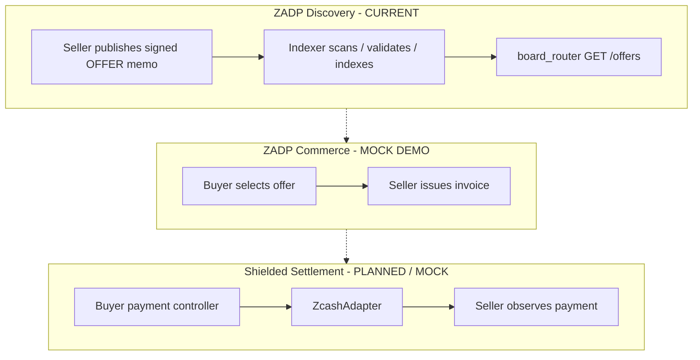
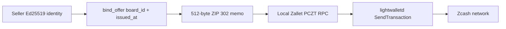
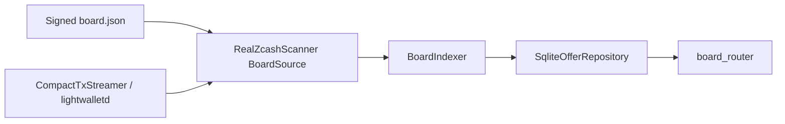
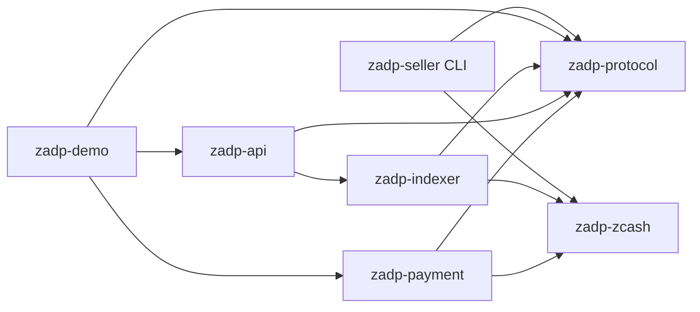
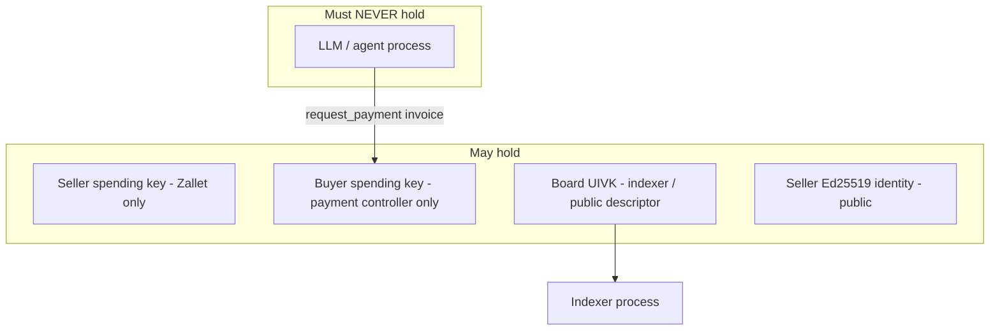

# ZADP Architecture

**ZADP** (Zcash Agent Discovery Protocol) is an open protocol and reference implementation for discovering signed service offers published through Zcash shielded memos.

This document describes the **current** architecture: real CompactTxStreamer scanning + SQLite indexing + read-only board API, plus a retained **mock** commerce vertical slice. Live mainnet publish → mine → scan → API acceptance is **not** claimed complete.

## Goals

- Sellers publish cryptographically signed service offers via Zcash shielded memos on an operator-defined board.
- An indexer discovers, validates, and exposes offers over a read-only REST API.
- AI/LLM processes may **request** payment but must **never** hold or use a Zcash spending key.
- Settlement (buyer→seller shielded payment) is a **related / planned** capability; the mock demo exercises it locally only.

## Non-goals (current milestone)

Marketplace UI, reputation, escrow, DID, production hosted wallets, tokens, DAO governance, recommendation engines, and blockchain abstraction frameworks are out of scope.

## Conceptual layers

Discovery is the production path under active implementation. Commerce and settlement remain mock-only except where explicitly noted.

## Current publication path

Privileged seller boundary (`zadp-seller publish`): protected local identity → canonical signed OFFER → authenticated loopback Zallet PCZT proposal → fee/destination preview → explicit confirmation (or `--dry-run`) → local prove/sign/extract → local final-tx verification → lightwalletd broadcast. Spending keys never leave the wallet process. See [mainnet-publishing.md](./mainnet-publishing.md).

## Current scanning / indexing / API path

1. Operator supplies a signed `BoardDescriptor` (Orchard-only UA, UIVK, birthday, policy).
2. `RealZcashScanner` fetches compact blocks, trial-decrypts against the board receiver, fetches full matching transactions, and recovers memos.
3. `BoardIndexer` validates framing, signature, semantics, and board admission; SQLite admits offers and advances the cursor in the same transaction.
4. `zadp-api` exposes `GET /healthz` and `GET /offers` only (`board_router`).

See [zcash-scanning.md](./zcash-scanning.md).

## Component diagram

| Crate | Responsibility | Must not |
| --- | --- | --- |
| `zadp-protocol` | Messages, board descriptor, canonical signing, 512-byte memo encode/decode | HTTP, storage, wallet RPC |
| `zadp-zcash` | `BoardSource` + `RealZcashScanner`; `ZcashAdapter` + `MockZcashAdapter`; lightwalletd client | Business admission beyond transport |
| `zadp-indexer` | Validate → SQLite persist → reorg-aware sync | HTTP frameworks, AI models, spending keys |
| `zadp-api` | Board scanner binary + `board_router`; mock `router()` for demo | Wallet secrets |
| `zadp-payment` | Spending policy + `request_payment` (mock path) | LLM SDKs; exposing spending keys |
| `zadp-seller` | Identity, `board-sign`, Zallet `publish`; mock seller service | Buyer wallet internals |
| `zadp-demo` | One-command mock vertical slice | Real broadcast |

Business logic depends on traits at infrastructure boundaries (`OfferRepository`, `BoardSource` / `ZcashAdapter`, `Clock`).

## Trust and key separation

**Invariant:** no AI or LLM process may possess a Zcash spending key.

Seller **identity keys** (Ed25519) sign offers independently of Zcash transaction keys. Board **UIVK** makes board-bound values and memos visible to descriptor holders by design; it does not authorize spends.

## CompactTxStreamer boundary

| Role | Interface | Authority |
| --- | --- | --- |
| Scan / index | CompactTxStreamer (compact blocks + `GetTransaction`) + board UIVK | View board outputs only |
| Publish | Local Zallet full-node/wallet PCZT RPC | Spend seller funds |
| Broadcast | lightwalletd `SendTransaction` after local verify | Relays already-signed tx |

The indexer never needs a spending key. Publication and scanning are deliberately separate processes and credentials.

## Mock commerce data flow (demo only)

1. Seller creates a signed `offer` (Ed25519 over canonical bytes).
2. Seller publishes via `ZcashAdapter::publish_message` (in-memory mock board).
3. Indexer scans, verifies, stores the offer.
4. Buyer queries `GET /offers?capability=...` on the **full** mock `router()`.
5. Buyer `POST /v1/invoices`; `zadp-payment` returns `ALLOW` / `DENY` / `REQUIRE_APPROVAL`.
6. On `ALLOW`, mock adapter records payment; seller fulfills via `POST /v1/fulfill`.

This path does **not** prove live-network discovery acceptance.

## Storage

| Path | Store |
| --- | --- |
| Real board discovery | SQLite (`SqliteOfferRepository`): metadata (board fingerprint), blocks, offers, rejections; WAL; admit + cursor in one transaction; reorg rewind cascades |
| Mock demo | In-memory repositories |

## Encoding strategy

| Representation | Use |
| --- | --- |
| JSON | REST, board descriptor files, human examples |
| Canonical CBOR map + `ZADP1\0offer\0` prefix | Ed25519 signing (`zadp1-sign-v1`) |
| ZIP 302 memo: `0xf5` + `ZADP` + wire v1 + u16 BE length + CBOR **tuple** + zero pad to 512 | On-chain OFFER transport (implemented) |

Signing serialization and memo wire CBOR are **different shapes**; see [protocol.md](./protocol.md).

## Hosted product coexistence

The open protocol and reference crates must remain useful without any hosted service. Optional hosted indexing, search, or managed APIs may be offered commercially while self-hosting remains valid.

## Status boundaries

| Capability | Status |
| --- | --- |
| Signed OFFER + memo framing + board binding | Implemented |
| CompactTxStreamer scanner + SQLite indexer + `board_router` | Implemented (code + offline tests) |
| Seller CLI publish (Zallet PCZT) | Implemented (developer preview) |
| Live mainnet acceptance evidence | **Pending** |
| Real shielded purchase settlement | **Not implemented** (mock only) |
| `offer_update` / `offer_revoke` | Specified only |

Unresolved integration work: [zcash-integration-todos.md](./zcash-integration-todos.md), [roadmap.md](./roadmap.md).
