# ZADP architecture

Current reference architecture; encoding requirements belong to the
[normative Protocol 1.0 specification](protocol.md). Operations and product
policy belong to their separate repositories, not the protocol.

## Publication, discovery and interaction

```mermaid
flowchart LR
  Sign[Local seller identity signs wire-3 Offer] --> Wallet[Local wallet / exact approval]
  Wallet --> Chain[Zcash shielded memo]
  Chain --> Scan[Board incoming-only scanner]
  Scan --> DB[Isolated per-board canonical SQLite]
  DB --> API[Read-only discovery API]
  API --> Client[Browser / agent local matching]
  Client --> Seller[Verified seller HTTPS origin]
  Client --> Controller[PaymentController / human approval]
  Controller --> BuyerWallet[Separate buyer wallet]
  BuyerWallet --> Payment[Shielded seller payment]
  Payment --> Observer[Seller incoming-only observer]
  Observer --> Result[Confirmed exactly-once fulfillment]
```

The publication CLI and payment wallet are trusted local boundaries. The indexer,
API and seller fulfillment have no spending key. Agents receive InvoiceView,
not keys or general signing authority. The controller enforces ALLOW/DENY/
REQUIRE_APPROVAL; tests or a quote do not authorize a real payment.

## Protocol primitives

New Offers use wire 3: `geo?`, `price?`, `commerce.endpoint?`, signed independently.
No endpoint/price is discovery; endpoint without price is a service announcement;
endpoint plus fixed price is a purchasable candidate; price without endpoint is
invalid. Geo is optional throughout. Legacy wire 1/2 are historical readers only.
BoardDescriptor v1 defines network/address/incoming viewing scope/birthday/policy.
Signing CBOR maps and the 14-element transport tuple are different shapes.
The current domain separator is `ZADP3\0offer\0`; memo payload is at most 504 bytes.
No canonical signed field, format or historical byte is changed by this document.

## Independent scanning and canonical storage

`RealZcashScanner` reads compact blocks, trial-decrypts to the board receiver,
then fetches matching full transactions for memo/value recovery. Transport data
is not consensus validation. BoardIndexer validates signature, inclusion-time
policy, expiry, minimum value and replay rules. Cursor/admission are transactional;
reorg rewind removes orphan state. Independent operators can reconstruct from
the same descriptor birthday. SQLite pins descriptor fingerprint and refuses
silent mixing. A descriptor-policy change requires separate reconstruction and
validation before operator activation; do not overwrite the active database.

Expired Offers stay historical but leave active discovery at `now >= expires_at`.
Renewal creates a new signed Offer. Update/revoke are not implemented.
Host visibility can omit valid records without modifying their canonical state.
See [scanning](zcash-scanning.md), [boards](board-descriptor.md),
[multi-board operation](multi-board.md) and [HTTP routes](api.md).

## Client geography

Public service-area geometry is seller-declared, not verified physical presence.
Seller browser GPS is requested explicitly and rounded locally before review;
manual e5 coordinates retain chosen precision. Rounding is not anonymization.
Buyer GPS and search radius remain transient client state. Nearby computes
Haversine circle intersection locally; no buyer coordinates are added to requests,
URLs, logs, storage, orders or Zcash. A compromised browser/OS is outside this
application guarantee. Ordinary IP/access metadata is still visible to servers.
Web owns globe/cartography/search/rendering, including separate synthetic demos;
Core owns interoperable geo primitives and matching. See [privacy](privacy.md).

## Endpoint verification and seller order flow

An offline Ed25519 proof at `/.well-known/zadp` binds identity to HTTPS origin.
It proves domain control, not KYC, `/orders` support, service quality or delivery.
The API's bounded asynchronous verifier uses public-unicast pinned DNS,
normal TLS, no proxy/redirects, strict time/body/concurrency/cache bounds and
only the well-known path. It is separate from canonical board scanning.
Endpoint downtime cannot invalidate an otherwise visible signed Offer.

For hosted Buy, combine active signature/admission/visibility, current origin
proof, signed fixed price, supported capability/transport and live Offer-specific
`orders_available`. Discovery `purchase_available` is eligibility, not a live
seller availability promise. No-price verified services expose a link, no invoice.

Direct seller POST /orders yields exact amount/recipient/memo/ZIP-321 and a
private recovery capability. Separate wallet approval precedes payment. Seller
incoming-only observations correlate exact shielded output/value/memo, wait for
confirmations and execute once. Repeat retrieval rechecks payment evidence;
previously delivered information cannot be recalled after reorg. No automatic
refund, escrow or delivery atomicity is guaranteed. See [commerce](commerce.md).

## Repository responsibilities

- Core: protocol, scanner/indexer/API, local signing/publication CLI, reusable
  clients, PaymentController and small reference seller/offline demos.
- Web: zadp.io product, local globe/search/matching, drafts and direct seller UX.
- Seller: hosted approved multi-Offer catalog, isolated order DBs, incoming-only
  observation, routing and deterministic fulfillment; no publication HTTP route.
- Server: instance configuration, exact-SHA deployment, backups, rollback, host
  policy and detailed sanitized acceptance records. Secrets stay outside Git.

Seller DB input/result are plaintext protected by permissions, not encrypted
against its operator. Target retention exists but automated purge/redaction is
not implemented. Logical separation from discovery is not isolation from a
shared-host operator. Board viewing capability is intentionally readable to its
holders and cannot spend. See [threat model](threat-model.md).

## Evidence boundaries

Mainnet discovery/geo reconstruction and one **human** buyer→seller purchase
are verified. Hosted multi-Offer Seller is deployed; original summary orders are
enabled, Tokyo/Shanghai live-demo orders disabled. Agent payment/fulfillment is
accepted only offline/synthetic so far; live unpaid preparation proves no payment.
Core's `zadp-demo` and Python local summary bridge remain test/legacy fixtures,
not production architecture. Board federation is future design.
See [mainnet evidence](mainnet-evidence.md) and [roadmap](roadmap.md).
