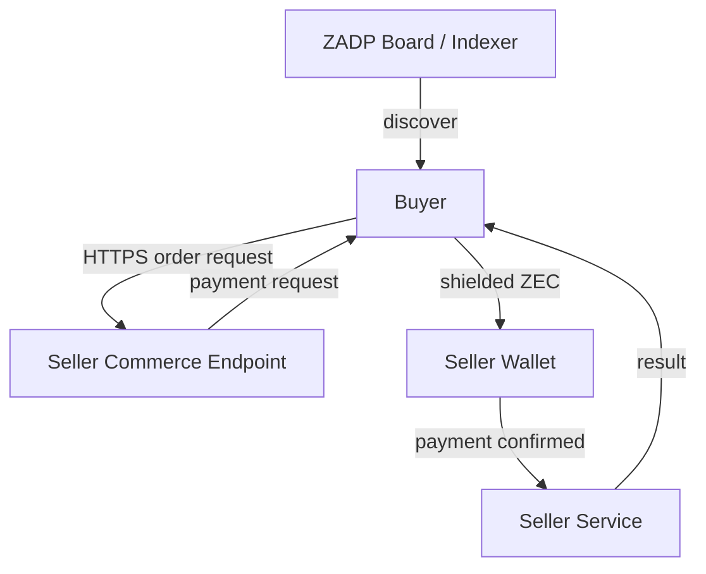

# Direct seller commerce

Discovery answers **what is for sale**. A seller commerce endpoint answers **how
to buy one offer and retrieve its result**. Zcash carries payment directly from
buyer to seller. The ZADP discovery host is not a payment intermediary: it holds
no buyer orders, payment identifiers, negotiated prices, input or results.

## Reference implementation boundary

`zadp-commerce` is an independently runnable Rust seller service. It reuses the
existing signed offer's `endpoint`; no OFFER wire change is needed. An endpoint
may represent a direct service or a seller commerce API. The reference capability
is `text.uppercase`, with seller-specific `{ "text": "hello world" }` input.
Future sellers may define different input/result schemas for digital services,
physical delivery or appointments. These fields remain outside discovery.

The new private orders database is separate from board databases and the existing
local text-summary invoice database. No runtime migration, account creation,
address change or additional mainnet publication is part of this implementation.
Checkpoint `05975d2` added board audit/moderation tables without changing existing
offer storage; descriptor/policy fingerprints still constrain database reuse.

## Orders and anonymous authorization

`POST /orders` accepts `offer_id` and `request.text`. A random 256-bit
`Idempotency-Key` is a private recovery capability. It is never sent to discovery.
The claim token is derived with a separate SHA-256 domain from that random key;
only hashes of both credentials are persisted. Repeating the same key and body
recovers the same order/token; using it with a different body is a conflict.
Clients must generate keys with a cryptographic random generator, not a counter.

`GET /orders/{id}` requires `Authorization: Bearer <claim_token>`. Unknown orders
and invalid tokens have the same response. Tokens never belong in URLs or logs.
The browser retains only the endpoint, order ID and private recovery credential;
not the service input. Anyone with access to that browser storage can claim the
order. The discovery API has no order creation, payment or result routes.

## Durable state and payment evidence

Normal transitions are `created → waiting_payment → paid → processing → completed`.
Unpaid orders may become `expired` or `cancelled`; execution failure becomes
`failed`. State transitions and deterministic execution/result storage are
transactional. Restart/poll/repeated observation cannot execute a completed order
twice. Cancellation applies only before payment and is authenticated.

Each order uses a random unique memo `ZADP-COMMERCE/1:<order_id>:<payment_ref>`.
The ZIP-321 request contains recipient, exact ZEC amount and that memo. Its QR
encodes the complete URI, never an address-only payment. Network fees are separate
and must be reviewed in the buyer wallet before approval. A reused receive address
is an MVP privacy tradeoff; separate shielded receivers may be added later.

Only an authenticated, fully synchronized seller-wallet observation can accept a
real payment: account, shielded pool, recipient, exact amount, memo, non-change
output, mining time inside the order window and configurable confirmations must
match. One output may be consumed once. Underpayments/overpayments, late mining
and buyer-supplied transaction claims do not fulfill orders. Cached results are
withheld if current evidence is unavailable or reorganized. Already retrieved
results cannot be recalled. The local observer is read-only; it never signs or
broadcasts. Mock evidence is supplied through a local file in explicit demo mode,
not through a remotely accessible payment endpoint.

## Direct browser flow

Buy on an eligible offer opens a seller-specific order form. The browser calls
the advertised seller endpoint directly, shows amount/expiry/ZIP-321 QR, polls
status and retrieves the result with its claim token. HTTPS and seller CORS are
required outside the explicit loopback demo. Orders do not pass through the
discovery server. HTTPS alone does not prove seller quality; indexer acceptance
and signature provenance are not fulfillment guarantees.

The same API serves browser, CLI and agents. An agent may consume the payment URI
but a separate payment controller must enforce policy and obtain approval. The
LLM must never receive spending keys. This reference implementation does not
automatically pay, sign, broadcast or publish.

## Availability and receipts

Payment is private buyer–seller state, never a public PAID message. Recurring
offers may remain available; a seller may separately publish UPDATE/CLOSE when
inventory changes, under existing protocol and approval rules. A future private
signed receipt can bind order, paid amount/time and seller identity; it must not
be written to a public board. Receipt signing is deferred.

Escrow, disputes, identity/KYC, reputation, shipping, public purchase history,
commissions, subscriptions and external AI providers are outside this slice.

## Next real-payment gate

First run the isolated mock vertical slice. A real test then requires a reachable
HTTPS seller endpoint, an active signed offer pointing to it, confirmed ownership
of the seller receiver, a synchronized read-only observer, and an independent
buyer wallet. Create exactly one order, inspect its full URI/memo and obtain a
wallet-generated fee preview for human approval. Only an explicitly approved
payment may then be sent. The expired placeholder mainnet offer and earlier
self-payment do not prove this independent buyer-to-seller flow and must not be
retried automatically.
