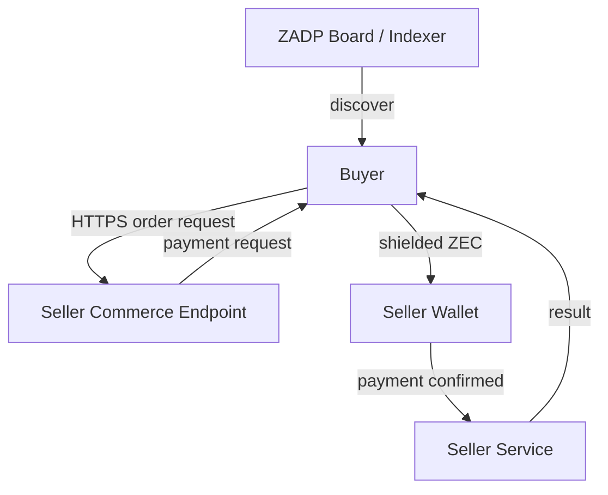

# Direct seller commerce

Discovery answers **what is for sale**. A seller commerce endpoint answers **how
to buy one offer and retrieve its result**. Zcash carries payment directly from
buyer to seller. The ZADP discovery host is not a payment intermediary: it holds
no buyer orders, payment identifiers, negotiated prices, input or results.



## Reference implementation boundary

`zadp-commerce` is an independently runnable Rust seller service. It reuses the
existing signed offer's `endpoint`; no OFFER wire change is needed. An endpoint
may represent a direct service or a seller commerce API. The reference capability
is `text.uppercase`, with seller-specific `{ "text": "hello world" }` input.
Future sellers may define different input/result schemas for digital services,
physical delivery or appointments. These fields remain outside discovery.

The new private orders database is separate from board databases and the existing
local text-summary invoice database. No runtime migration, account creation,
address change or additional mainnet publication is part of this implementation.
Checkpoint `05975d2` added board audit/moderation tables without changing existing
offer storage; descriptor/policy fingerprints still constrain database reuse.

## Orders and anonymous authorization

`POST /orders` accepts `offer_id` and `request.text`. A random 256-bit
`Idempotency-Key` is a private recovery capability. It is never sent to discovery.
The claim token is derived with a separate SHA-256 domain from that random key;
only hashes of both credentials are persisted. Repeating the same key and body
recovers the same order/token; using it with a different body is a conflict.
Clients must generate keys with a cryptographic random generator, not a counter.

`GET /orders/{id}` requires `Authorization: Bearer <claim_token>`. Unknown orders
and invalid tokens have the same response. Tokens never belong in URLs or logs.
The browser retains only the endpoint, order ID and private recovery credential;
not the service input. Anyone with access to that browser storage can claim the
order. The discovery API has no order creation, payment or result routes.

## Durable state and payment evidence

Normal transitions are `created → waiting_payment → paid → processing → completed`.
Unpaid orders may become `expired` or `cancelled`; execution failure becomes
`failed`. State transitions and deterministic execution/result storage are
transactional. Restart/poll/repeated observation cannot execute a completed order
twice. Cancellation applies only before payment and is authenticated.

Each order uses a random unique memo `ZADP-COMMERCE/1:<order_id>:<payment_ref>`.
The ZIP-321 request contains recipient, exact ZEC amount and that memo. Its QR
encodes the complete URI, never an address-only payment. Network fees are separate
and must be reviewed in the buyer wallet before approval. A reused receive address
is an MVP privacy tradeoff; separate shielded receivers may be added later.

Only an authenticated, fully synchronized seller-wallet observation can accept a
real payment: account, shielded pool, recipient, exact amount, memo, non-change
output, mining time inside the order window and configurable confirmations must
match. One output may be consumed once. Underpayments/overpayments, late mining
and buyer-supplied transaction claims do not fulfill orders. Cached results are
withheld if current evidence is unavailable or reorganized. Already retrieved
results cannot be recalled. The local observer is read-only; it never signs or
broadcasts. Mock evidence is supplied through a local file in explicit demo mode,
not through a remotely accessible payment endpoint.

## Direct browser flow

Buy on an eligible offer opens a seller-specific order form. The browser calls
the advertised seller endpoint directly, shows amount/expiry/ZIP-321 QR, polls
status and retrieves the result with its claim token. HTTPS and seller CORS are
required outside the explicit loopback demo. Orders do not pass through the
discovery server. HTTPS alone does not prove seller quality; indexer acceptance
and signature provenance are not fulfillment guarantees.

The same API serves browser, CLI and agents. An agent may consume the payment URI
but a separate payment controller must enforce policy and obtain approval. The
LLM must never receive spending keys. This reference implementation does not
automatically pay, sign, broadcast or publish.

## Availability and receipts

Payment is private buyer–seller state, never a public PAID message. Recurring
offers may remain available; a seller may separately publish UPDATE/CLOSE when
inventory changes, under existing protocol and approval rules. A future private
signed receipt can bind order, paid amount/time and seller identity; it must not
be written to a public board. Receipt signing is deferred.

Escrow, disputes, identity/KYC, reputation, shipping, public purchase history,
commissions, subscriptions and external AI providers are outside this slice.

## Next real-payment gate

First run the isolated mock vertical slice. A real test then requires a reachable
HTTPS seller endpoint, an active signed offer pointing to it, confirmed ownership
of the seller receiver, a synchronized read-only observer, and an independent
buyer wallet. Create exactly one order, inspect its full URI/memo and obtain a
wallet-generated fee preview for human approval. Only an explicitly approved
payment may then be sent. The expired placeholder mainnet offer and earlier
self-payment do not prove this independent buyer-to-seller flow and must not be
retried automatically.

## Run the isolated vertical slice

From the repository root, use a **new private directory outside the repository**:

```sh
cargo build -p zadp-commerce --bins --examples
cargo run -p zadp-commerce --example fixture -- /absolute/private/commerce-demo
python3 ui/dev_commerce_fixture.py --directory /absolute/private/commerce-demo
```

Open `http://127.0.0.1:8095`. The isolated discovery fixture is on 8096; the
independent Rust seller is on 8094. The existing mainnet UI on 8090 and discovery
API on 8080 are not reconfigured. Choose the explicitly labeled local offer,
click **Buy directly from seller**, enter `hello world` and prepare an order.
The demo's synthetic testnet receiver has no retained spending authority: **never
fund it**. Its QR is a demonstration of encoding, not a request to transfer funds.

Supply an observation locally using the displayed order ID:

```sh
python3 examples/commerce/mock_payment.py \
  --directory /absolute/private/commerce-demo --order ORDER_ID --confirmations 1
# The UI must show confirming and withhold the result.
python3 examples/commerce/mock_payment.py \
  --directory /absolute/private/commerce-demo --order ORDER_ID --confirmations 3
# Subsequent polls show paid, processing, then completed: HELLO WORLD.
```

Reload the browser, check again, or restart the seller using the same configuration
and database. One order remains one execution. Neither the mock tool nor the
seller HTTP API can send a transaction. The mock file must be owned/private;
there is deliberately no HTTP payment injection route.

For a CLI client, use `examples/commerce/buyer.py create` with `--endpoint`,
`--offer`, `--text-file` and a new protected `--recovery` file, then `check` with
that same endpoint/recovery file. Add `--demo` only for the explicit mock origin.
The CLI prints payment details but suppresses the claim token; it never pays.
A lost creation response can be retried with the same key and same input; input
is not retained in browser storage, so re-enter it exactly when needed.

## Seller configuration and API contract

Run `zadp-commerce --config /private/seller.json`. Configuration must be an owned
regular file with no group/other permissions (0600), in a private directory.
Fields are `offer` (the signed OFFER JSON), `network`, `recipient`,
`seller_account`, `database`, `confirmations` (1–100), `order_lifetime_seconds`
(60–86400), `browser_origin` (one exact origin), and `observer`:

```json
{"mode":"zallet","rpc_url":"http://127.0.0.1:28232","auth_file":"/private/rpc.auth"}
```

Use an existing seller account/address, never the public board receiving
account or its UIVK. A board incoming viewing key is sufficient for discovery;
it grants neither spending authority nor access to unrelated buyer/seller wallet
payments. This new service observes only its seller account via authenticated
local RPC. The account UUID and auth path are private deployment configuration,
never discovery fields or public examples containing real wallet data.

The binary binds HTTP on loopback only. A real seller deploys an HTTPS reverse
proxy in front of it and serves the reference API at the advertised origin.
Non-root commerce base paths are not yet supported by this reference client.
Real configuration requires HTTPS for both endpoint and browser origin. CORS
allows only that origin, without browser cookies. Origin-bearing requests from
other browsers are rejected; CLI requests may omit Origin. A reverse proxy must
not log Authorization or Idempotency-Key headers, request bodies or response
bodies. Anonymous order creation also needs deployment rate limiting and abuse
controls; the reference has hard limits of 100 active and 10,000 total orders.

- `POST /orders`: JSON `{"offer_id":"…","request":{"text":"hello world"}}`,
  `Content-Type: application/json`, `Idempotency-Key: <random 64 lowercase hex>`.
  Returns order ID/state, claim token, network/simulation flag, exact amount,
  recipient, memo, ZIP-321 URI, QR SVG, expiry and confirmation policy.
- `GET /orders/{id}`: Bearer token required. Returns payment-check state,
  confirmation count and durable transition history; `result` appears only for
  a completed order with freshly verified evidence. Claim tokens are not returned
  by GET. The reference reconciles and advances work on authenticated polling;
  continuous unattended reconciliation is a future worker extension.
- `DELETE /orders/{id}`: Bearer token required; cancel only before accepted
  payment. Cancellation is not a refund and cannot reverse a transfer.
- `GET /healthz`: service liveness only, not wallet readiness.

Input is limited to 4,000 UTF-8 bytes; result to 12,000 bytes. Unknown JSON fields,
unsupported offers and precision beyond eight decimal ZEC places are rejected.
Errors omit wallet/RPC details. Orders expire at the earlier of their payment
window and signed offer expiry. A payment first observed within the window may
wait beyond expiry for confirmations; terminal expired/cancelled orders do not
reopen. Block timestamps are the reference's payment-window evidence and may
require operational tolerance in a later production policy.

The browser validates response binding (offer/order, network, price, expiry and
memo), generates its own QR from the validated URI and ignores seller-provided
SVG. No remote QR service is contacted. Capability credentials never go into
query strings. The vendored browser QR encoder is `qrcode-generator` 1.4.4 under
MIT; Rust uses `zip321` 0.9 and `qrcode` 0.14.

The orders schema is version 1. Startup rejects a database containing another
service's tables, unsupported schema versions or changed configuration. Renewing
an offer, changing observer/account/policy or retaining orders across such a
change requires an explicit migration design or a separate new database; do not
silently delete old orders. No migration of existing mainnet databases is needed.
The Zallet observer fails closed on synchronization locks, tip changes,
malformed responses or history exceeding its 1,000-transaction pagination bound.
It is not yet a production incremental observer for high-volume sellers.
