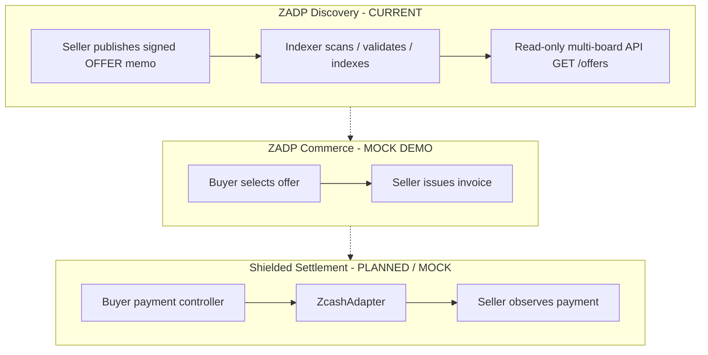
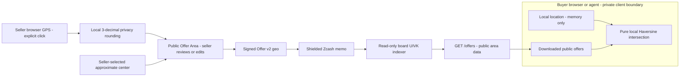
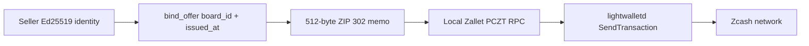
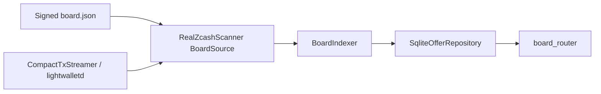
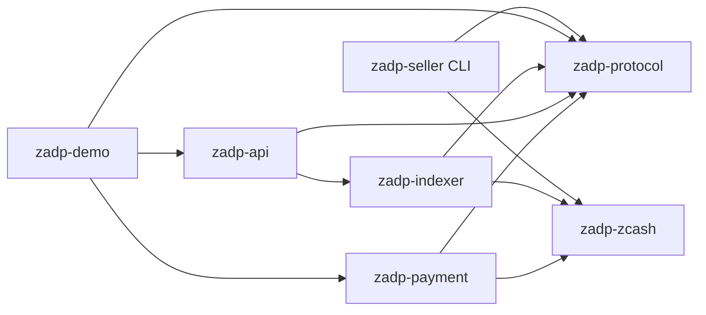
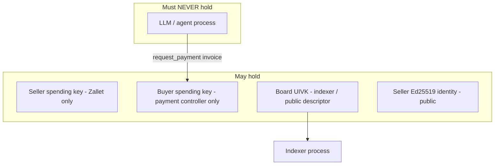

# Preserved architecture diagrams

> **Historical document.** These original diagrams are retained unchanged. Their mock/planned labels describe the earlier reference milestone, not current production. See [current architecture](../architecture.md).

