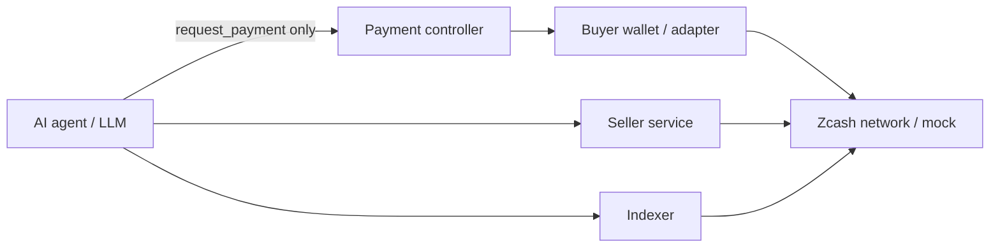

# ZAP Threat Model (Phase 1)

This threat model focuses on the MVP architecture and the invariants that must hold as real Zcash integration is added.

## Assets

| Asset | Sensitivity |
| --- | --- |
| Buyer Zcash spending key | Critical |
| Seller Zcash spending key | Critical |
| Indexer viewing capability / board scan material | High |
| Seller identity private key (offer signing) | High |
| Offer authenticity and freshness | High |
| Invoice / order metadata in shielded memos | High |
| Buyer purchase graph | High (privacy) |
| Indexed offer catalog integrity | Medium |

## Trust boundaries

**Hard invariant:** no AI or LLM process may possess a Zcash spending key. The agent may request payment; only the payment controller + wallet adapter may sign/spend.

## Threats and mitigations

### Compromised LLM / prompt injection

- **Risk:** Agent is manipulated into requesting many payments, wrong sellers, or exfiltrating data it can see.
- **Mitigations:** Spending policy (`max_single`, `max_daily`, `require_human_approval_above`); agent never receives spending keys; least-privilege tool surface (`request_payment` only); human approval path for larger amounts.
- **Residual:** Agent can still spam invoice requests and leak non-secret offer data.

### Malicious seller

- **Risk:** Fake capability, bait pricing, non-delivery after payment, malicious endpoint.
- **Mitigations (MVP):** Cryptographic offer identity; clear endpoint binding; no escrow yet — buyer accepts counterparty risk. Future: reputation, bonds, dispute flows (out of scope now).
- **Residual:** MVP does not guarantee service quality.

### Malicious offer / modified offer

- **Risk:** Attacker alters price, endpoint, or capability in transit or in indexer storage.
- **Mitigations:** ed25519 signature over canonical CBOR; indexer verifies before indexing; buyers should re-verify signature on retrieved offers (Phase 1 demo verifies at index time; clients SHOULD verify too).

### Replayed offer

- **Risk:** Rebroadcast of an old valid signed offer.
- **Mitigations:** `expires_at` enforcement; `nonce` bound into signature; offer `id` uniqueness in indexer. Full anti-replay against chain reorg/memo re-scan semantics is unresolved for real Zcash.

### Stale / expired offer

- **Risk:** Buyer pays against expired terms.
- **Mitigations:** Indexer rejects expired offers; invoice expiry; seller must re-check offer validity when issuing invoices.

### Compromised indexer

- **Risk:** Censorship, injection of fake offers, selective omission, surveil query patterns.
- **Mitigations:** Clients can verify offer signatures independently of indexer trust; multiple indexers possible later; viewing key compromise does not equal spending compromise.
- **Residual:** A malicious indexer can still lie by omission or serve only attacker-favored valid offers.

### Leaked viewing capability

- **Risk:** Third party can read ZAP board memos / payment memos visible to that view authority.
- **Mitigations:** Separate viewing from spending; minimize who holds view material; treat board as pseudonymous public discovery surface for offers (offers are meant to be discoverable). Payment memos should remain limited to parties with payment view rights — exact Zcash key topology unresolved.

### Leaked spending key

- **Risk:** Total loss of funds.
- **Mitigations:** Spending keys only in payment controller / wallet process; never in LLM context, logs, or indexer; mock adapter uses fake keys; real integration must use OS secret storage / hardware where possible.

### Excessive autonomous spending

- **Risk:** Runaway agent drains wallet.
- **Mitigations:** Policy engine (`ALLOW` / `DENY` / `REQUIRE_APPROVAL`); configurable ceilings; structured audit log of payment requests and decisions.

### Denial-of-service / spam offers

- **Risk:** Flood board with validly signed junk offers.
- **Mitigations (MVP):** In-memory limits only. Future: proof-of-payment to publish, rate limits, stake, capability allowlists, indexer policy filters.

### Endpoint / SSRF style abuse

- **Risk:** Offer points `endpoint` at internal resources; buyer/indexer fetch unsafely.
- **Mitigations:** Demo uses localhost; production clients should restrict schemes/hosts and not follow arbitrary redirects with secrets.

## Explicit non-protections in Phase 1

- No escrow or payment-vs-delivery atomicity.
- No formal reputation or identity beyond pubkey.
- Mock Zcash provides **no** real privacy.
- No consensus-level spam resistance.

## Security checklist for contributors

- [ ] Never pass spending keys into agent/LLM prompts, tools, or traces.
- [ ] Verify offer signatures before trust.
- [ ] Enforce invoice and offer expiry before payment.
- [ ] Keep policy decisions outside the model.
- [ ] Log payment *decisions* without logging secrets.
