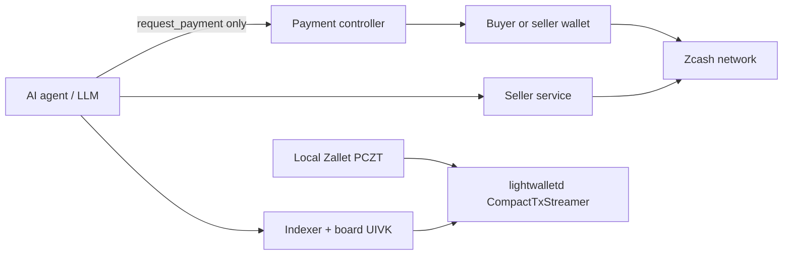

# ZADP Threat Model

Canonical wire 3 signs optional endpoint and fixed price independently. Price requires endpoint; endpoint without price allows no payment. Geo is optional. Legacy wire 1/2 remain frozen read compatibility. See [protocol](protocol.md) and [privacy/data flow](privacy.md).

This threat model covers the **current** ZADP reference implementation: real CompactTxStreamer board discovery, SQLite indexing, seller publish CLI, the retained offline demos, trusted local publication tooling and independently deployed hosted Seller. Mainnet discovery/geo, paid wire-3 publications, a human purchase and agent-prepared human-paid fulfillment are recorded; a real agent-controller wallet purchase is recorded with same-operator legacy-service limits; independent-wallet-owner and wire-3 commerce acceptance remain separate. See [public evidence summary](mainnet-evidence.md).

## Assets

| Asset | Sensitivity |
| --- | --- |
| Buyer Zcash spending key | Critical |
| Seller Zcash spending key | Critical |
| Board UIVK / public board descriptor | High (intentional discovery surface) |
| Seller Ed25519 identity private key | High |
| Offer authenticity and freshness | High |
| Invoice / order metadata (experimental local service) | High |
| Buyer purchase graph | High (privacy) |
| Indexed offer catalog integrity | Medium |

## Trust boundaries

**Hard invariant:** no AI or LLM process may possess a Zcash spending key. The agent may request payment; only a separate payment controller + wallet may sign/spend. The indexer holds board **incoming viewing** material only.

## Threats and mitigations

Status labels: **Implemented** (in current code), **Partial**, **Remaining**.

### Compromised LLM / prompt injection

- **Risk:** Agent is manipulated into requesting many payments, wrong sellers, or exfiltrating data it can see. Public offer text/URLs may contain adversarial instructions.
- **Implemented:** Spending keys never in the model; mock path uses `request_payment` + policy (`ALLOW` / `DENY` / `REQUIRE_APPROVAL`) with ceilings; consumers must treat offer fields as untrusted text (escape, never execute as instructions).
- **Remaining:** Production AI buyer tooling, stronger human-approval UX, hosted gateway hardening.
- **Residual:** Agent can still spam invoice requests and leak offer or invoice inputs.

### Malicious seller

- **Risk:** Fake capability, bait pricing, non-delivery after payment, malicious HTTPS endpoint.
- **Implemented:** Ed25519 offer identity; endpoint bound into signed offer; board admission requires HTTPS with host and without userinfo; canonical scanner does **not** fetch endpoints. The API separately fetches only the restricted well-known origin proof.
- **Remaining:** Escrow, reputation, bonds, dispute flows (out of scope).
- **Residual:** No service-quality guarantee; buyer accepts counterparty risk for real purchases (one human purchase is verified, not a guarantee for other sellers/orders).

### Malicious buyer

- **Risk:** Abuse seller endpoints, unpaid load, scrape or DoS seller APIs.
- **Implemented:** Discovery is read-only. Hosted Seller uses incoming-only observation and gates results on exact confirmed shielded outputs; one human mainnet purchase completed exactly once. A later real agent-controller purchase also fulfilled once using separate accounts under one operator/wallet; this is not independent-wallet-owner or wire-3 commerce acceptance.
- **Implemented local gate:** Exact account/receiver/amount/memo, non-change shielded output, invoice mining window, three confirmations, single-output use and reorg rechecks. TLS verification and fixed loopback routing prevent arbitrary offer-controlled requests.
- **Remaining:** Stronger rate limits, safe retention/redaction implementation, refund policy and real agent-wallet acceptance. Origin proof and claim-token auth do not eliminate endpoint abuse.

### Forgery / modified offer

- **Risk:** Attacker alters price, endpoint, or capability in transit or in indexer storage.
- **Implemented:** Ed25519 over canonical CBOR (`ZADP3\0offer\0` for new Offers; unchanged legacy separators for historical verification); indexer verifies before admit; clients SHOULD re-verify retrieved offers.
- **Residual:** A compromised indexer can omit valid offers or prefer attacker-favored valid ones.

### Malformed / oversized payload

- **Risk:** Crash or confuse indexers with junk memos.
- **Implemented:** ZIP 302 framing checks (magic, supported wire 3 and historical 1/2, length ≤504, zero padding); unsupported types rejected; unrelated memos ignored; rejections store reason codes/output ids — not raw private memo content.

### Replay / duplicate publication

- **Risk:** Rebroadcast of an old valid signed offer or double-admit of the same output.
- **Implemented:** `expires_at`; nonce bound into signature; SQLite first-wins on `(seller,id)`, `(seller,nonce)`, and `(txid,pool,output_index)`; duplicate outputs/blocks idempotent.
- **Remaining:** `offer_update` / `offer_revoke` wire acceptance.

### Expiry / reorg

- **Risk:** Buyer acts on stale terms; chain reorg orphans indexed offers.
- **Implemented:** API lists only unexpired offers; admission uses inclusion **block time** for TTL/rate; reorg rewind deletes orphan heights (cascades offers/rejections).
- **Residual:** lightwalletd is trusted for chain data; scanner is not a consensus-validating full node. Full-transaction requests can reveal which transactions interest the indexer.

### Compromised indexer

- **Risk:** Censorship, selective omission, query surveillance.
- **Implemented / design:** Clients can verify signatures independently; anyone can run another indexer from the same public descriptor; DB pins board fingerprint (silent descriptor swap refuses open).
- **Residual:** Omission and query logging remain possible for a malicious operator. Operator signatures authenticate a pinned key, not a real-world identity; pin the descriptor fingerprint through a trusted channel.

### Viewing / spending key exposure

- **Risk:** UIVK leak exposes board discovery traffic; spending key leak drains funds.
- **Implemented:** Dedicated board accounts recommended; UIVK ≠ spend; seller identity and wallet auth files are owner-only, regular, symlink-resistant (`O_NOFOLLOW`), never printed; publish path keeps spending in local Zallet; RPC bodies/errors suppressed to avoid wallet leaks.
- **Remaining:** Hardware-backed seller/buyer wallets; broader OS secret-store guidance.
- **Residual:** Public UIVK is an intentional discovery surface — board traffic is not private from descriptor holders. Use a dedicated board account to isolate discovery from personal and purchase traffic.

### Spam / Sybil on open boards

- **Risk:** Flood board with validly signed junk; many identities bypass per-seller caps.
- **Implemented:** `min_listing_value_zat`, per-seller active and rate-window limits, optional `authorized` allowlist.
- **Remaining:** Stronger economic admission controls, global quotas, and operator tooling; the listing-value requirement is already enforced.
- **Residual:** `open` admission remains Sybil-vulnerable; disk/network DoS via many incoming txs still possible.

### Malicious endpoints / SSRF-style abuse

- **Risk:** Offer `endpoint` points at internal resources; buyers fetch unsafely.
- **Implemented:** Canonical scanner does not fetch endpoints. The separate API proof verifier requires public-unicast DNS, pins its snapshot, rejects credentials/private addresses, proxies and redirects, and bounds time/body/concurrency/cache. Only `/.well-known/zadp` is fetched. See [endpoint proof](endpoint-ownership.md).
- **Remaining:** Every independent buyer must preserve endpoint/redirect/credential protections; domain control does not prove ordering support. Hosted Buy also checks live `orders_available`.

### Denial of service (API / DB)

- **Risk:** Overwhelm loopback or public API, fill SQLite, stall sync.
- **Partial:** Default listen `127.0.0.1:8080`; no sync-readiness on `/healthz` (liveness only).
- **Remaining:** Auth/TLS for non-loopback deploys, connection limits, metrics, operational runbooks.

### Publication path abuse / mistakes

- **Risk:** Wrong destination, fee surprise, double broadcast after timeout.
- **Implemented:** Library-derived fee preview; explicit `Proceed? [y/N]` (or `--dry-run`); final extracted tx verified (board output, memo, Orchard-only, value, fee, txid) before broadcast; public receipt option without wallet data.
- **Residual:** Network timeout can leave broadcast status unknown — check txid before retry.

## Explicit non-protections (current)

- No escrow or payment-vs-delivery atomicity.
- No formal reputation beyond pubkey / board allowlist.
- Offline/mock commerce provides **no** real privacy or settlement. The completed human purchase does not prove autonomous agent acceptance.
- No consensus-level spam resistance on `open` boards.
- No production board API authentication or TLS termination in-tree; local text TLS is development-only.

## Security checklist for contributors

- [ ] Never pass spending keys into agent/LLM prompts, tools, or traces.
- [ ] Verify offer signatures before trust.
- [ ] Enforce invoice and offer expiry before payment.
- [ ] Keep policy decisions outside the model.
- [ ] Log payment *decisions* without logging secrets.
- [ ] Treat public offer text/URLs as untrusted input.
- [ ] Pin board descriptor fingerprints through a trusted channel.

## Local operator UI boundary

Owner-only configuration and authentication remain in protected local processes.
The browser gets only filtered seller balance/synchronization/receiver data and
public unsigned publication previews. There is no sign/spend/broadcast route.
Cross-origin writes and unexpected Host headers are rejected; invoice tokens
are not placed in URLs. Hosted direct commerce deliberately stores a private recovery capability in browser storage, without input/result; access to that storage permits recovery. Local legacy tooling may differ. Draft offer strings remain
untrusted. A preview can sign an Ed25519 offer but never a Zcash transaction.

The paid service stores inputs privately in SQLite and cannot automatically
refund incorrect/late payments. Its bounded 1,000-transaction observer fails
closed on truncation or synchronization changes. Production needs durable
reorg/recovery policy, abuse/resource limits and privacy/retention controls.
A previously released result cannot be recalled after a later chain reorg;
subsequent retrievals can only withhold it. A mainnet invoice is not a buyer
transaction fee preview and must not be interpreted as permission to pay.

HTTP repository failures now return a generic error; detailed database errors
stay in operator logs. UI validates nested response shapes and does not claim
browser signature verification. Python wallet responses have bounded reads;
protected configuration/auth/database files require current-user ownership.
The text service caps stored invoices at 10,000 in addition to 100 active slots.
SQLite board history/rejections and public API concurrency remain unbounded over
long operation; production quotas/monitoring are still needed. Local TLS and
Origin/Host checks do not defend against a compromised local OS/user process.

## Geographic discovery privacy boundary

A precise **public offer-area center** can reveal a sensitive place. Geo is
optional, the seller is warned before enabling it, approximate centers are
encouraged and no street address is required. Zcash shielding does not make
indexed metadata private: descriptor/UIVK holders can read incoming offer
memos and the API exposes accepted geo. Signatures authenticate declarations,
not actual presence or service quality.

Browser geolocation can reveal a home, office or other sensitive physical place.
The reference seller UI requests it only after explicit seller action, rounds
browser-acquired coordinates to **three decimal degrees before populating public
Offer Area fields**, and lets the seller review/edit the center. Sellers may
choose an approximate center manually; geo remains optional. Manual precision
is seller-controlled within e5 rather than silently reduced to three decimals.

Rounding reduces accidental precision but **does not anonymize a seller**.
A rounded center may still reveal a small area. Three-decimal coordinate precision
is approximately 100-meter scale, not an exact fixed meter accuracy; longitude
distance varies strongly with latitude. No privacy guarantee follows from it.
The protocol can intentionally encode finer e5 values; this is a reference-client
publication policy, not a restriction on conforming offers or other clients.

A discovery operator could learn buyer coordinates from server-side geo queries.
The reference client instead downloads public offers and performs Haversine
circle matching locally. Buyer coordinates are transient client memory only:
no location-bearing fetch/XHR, analytics, logs, browser persistence, URL/history,
Zcash publication, seller call or order field. Geolocation is requested only
by buyer/seller buttons, never on load. Seller coordinates are a separate,
explicit public draft field and may be saved/exported by the seller.

This property is scoped to the reviewed application. The browser/OS location
provider, malicious extensions, compromised client, remote script replacement
or voluntary disclosure during later direct shipping/service orders are outside
it. The discovery host can still observe ordinary network metadata such as IP
addresses and offer-feed access; this is not a claim of full anonymity. No map
provider, reverse geocoder, tracking or external analytics is added.

Tests execute the actual browser app with synthetic location and intercepted
network/storage/logging, including denial and seller/buyer separation. See
[geo guide](geographic-discovery.md). Real device permission review remains important; first live geo acceptance is already recorded in [mainnet evidence](mainnet-evidence.md). New Offers still require separate exact approval.

## Seller storage today

Hosted Seller SQLite retains plaintext input/result and private payment/recovery
metadata. Target retention/redaction is documented but no automatic purge is
implemented. Preserve replay/idempotency records and executing orders; never
substitute ad-hoc deletion for reviewed cleanup. Discovery and seller may share
an operator, so logical routing separation does not prevent that operator reading
seller state. See [privacy](privacy.md).
